<h1>Robotics and Automation</h1>

**CS112, Intro to AI**

<h2>Table of Contents</h2>

[TOC]

## 1. The History of Robotics and Automation

### A. Origins of the Term & Cultural Concepts (Brief Side-Note)
* **Etymology of "Robot" (1920):**
  * Coined by Czech writer Karel Čapek (suggested by his brother Josef) in his science fiction play *R.U.R.* (*Rossum's Universal Robots*).
  * Derived from the Czech word *robota*, meaning "forced labor," "corvée," or "drudgery."
  * *Source:* [MIT Press Reader – The Origin of the Word "Robot"](https://thereader.mitpress.mit.edu/origin-word-robot-rur/)
  
  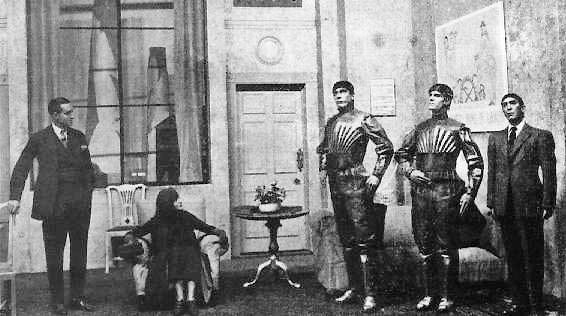  
  *A scene from Čapek's play R.U.R., showing three of the robots. Image: unknown photographer, [Wikimedia Commons](https://commons.wikimedia.org/wiki/File:Capek_play.jpg), public domain.*
* **Robotics in Literature and Film:**
  
  * **Isaac Asimov (1941–1942):** Coined the term *"robotics"* in his short story "Liar!" and introduced the famous **Three Laws of Robotics** in "Runaround" (later compiled in *I, Robot*), framing robots as rule-bound, helpful machines rather than inevitable monsters.
    * The First Law (Human Safety): A robot is prohibited from harming a human individual, and it cannot stand idly by and allow a human to suffer harm through its own inaction.
    * The Second Law (Obedience): A robot must follow any instructions given to it by human beings, provided that carrying out those commands does not violate the First Law.
    * The Third Law (Self-Preservation): A robot must safeguard its own continued existence and physical integrity, as long as doing so does not conflict with either the First or Second Law.
    * Zeroth Law that supersedes the original three—requiring that a robot must not harm humanity as a whole, or allow humanity to come to harm through inaction. (from *Robots and Empire*)
  
  * 
    * *Source:* [Britannica – Isaac Asimov and the Three Laws of Robotics](https://www.britannica.com/topic/Three-Laws-of-Robotics)
  * **Early Cinema:** *Metropolis* (1927) featured "Maria," one of the earliest visual depictions of a humanoid automaton on screen, establishing popular tropes around artificial beings.
    * *Source:* [Science Museum Group – Replica of the 'Maria' Robot from *Metropolis*](https://collection.sciencemuseumgroup.org.uk/objects/co8564807)

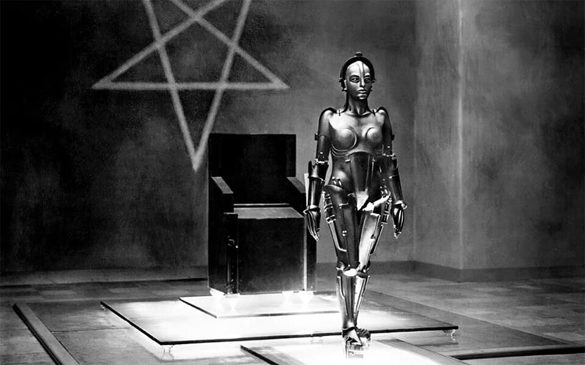  
*The Maschinenmensch ("machine-human") in a scene from Metropolis (1927). Image: Horst von Harbou, [Wikimedia Commons](https://commons.wikimedia.org/wiki/File:Maschinenmensch_in_a_scene_from_Metropolis.jpg), public domain.*

### B. Industrial Robotics (Manufacturing & Heavy Industry)
* **Unimate (1954 / 1961):**
  * Invented by George Devol and commercialized by Joseph Engelberger ("the father of robotics").
  * The first digitally operated, programmable robotic arm was installed at a General Motors plant in Ewing Township, New Jersey, in 1961 to handle hot die-cast metal parts and weld auto bodies.
  * *Source:* [IEEE Spectrum / Robotics Hall of Fame – Unimate](https://robotsguide.com/robots/unimate)
  * *Video:* [The Henry Ford – First Industrial Robot Ever Installed on an Assembly Line (3:20)](https://www.youtube.com/watch?v=-Xl2c91pWGc)
* **Programmable Electric Arms (Late 1960s–1970s):**
  * **Stanford Arm (1969):** Designed by Victor Scheinman, the first successful electrically powered, computer-controlled 6-axis articulating arm.
  * **PUMA (1978):** Unimation developed the *Programmable Universal Machine for Assembly* with GM, setting the standard for modern industrial assembly line robotics.
  * *Source:* [Stanford Magazine – Stanford's Robotic History](https://stanfordmag.org/contents/stanford-s-robotic-history)
* **Modern Collaborative Robots ("Cobots"):**
  * Unlike traditional industrial robots kept in safety cages, modern cobots use force-limiting sensors and computer vision to work safely alongside human technicians.
  * *Source:* [International Federation of Robotics (IFR) – History of Industrial Robots](https://ifr.org/robot-history)

  
*A 3,500-pound Unimate arm pours coffee at a 1967 demonstration in Los Angeles. Image: Frank Q. Brown, Los Angeles Times, [Wikimedia Commons](https://commons.wikimedia.org/wiki/File:Unimate_pouring_coffee_for_a_woman_at_Biltmore_Hotel,_1967.jpg), [CC BY 4.0](https://creativecommons.org/licenses/by/4.0/).*

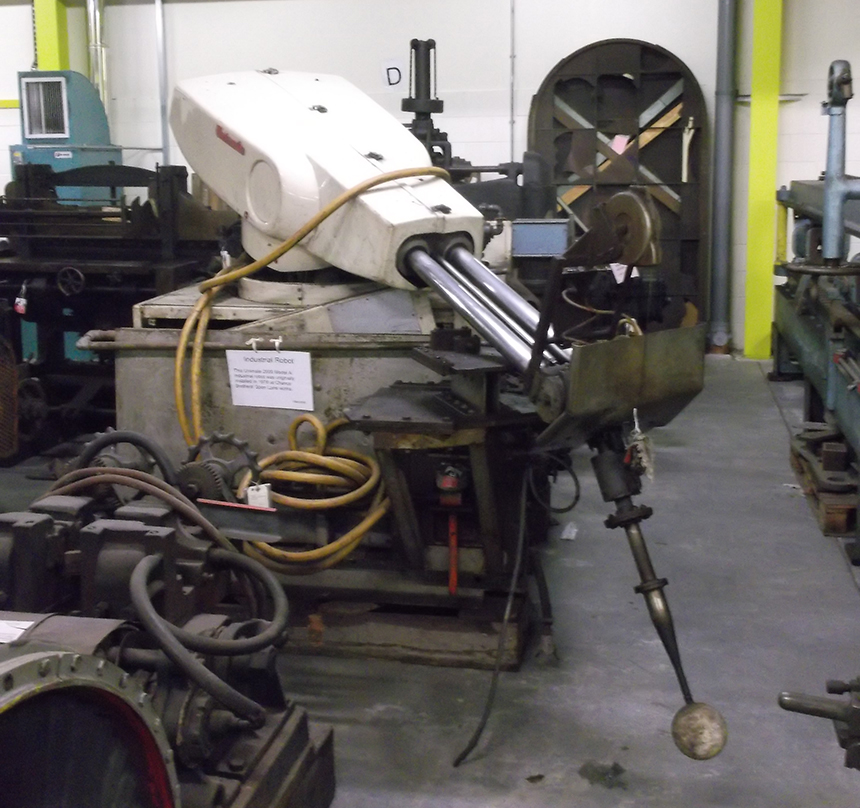  
*A hydraulic Unimate industrial robot that once worked in a factory, now in a museum store in Birmingham, England. Image: Phil Parker, [Wikimedia Commons](https://commons.wikimedia.org/wiki/File:Industrial_robot_Birmingham_museum_store.jpg), [CC BY 2.0](https://creativecommons.org/licenses/by/2.0/).*

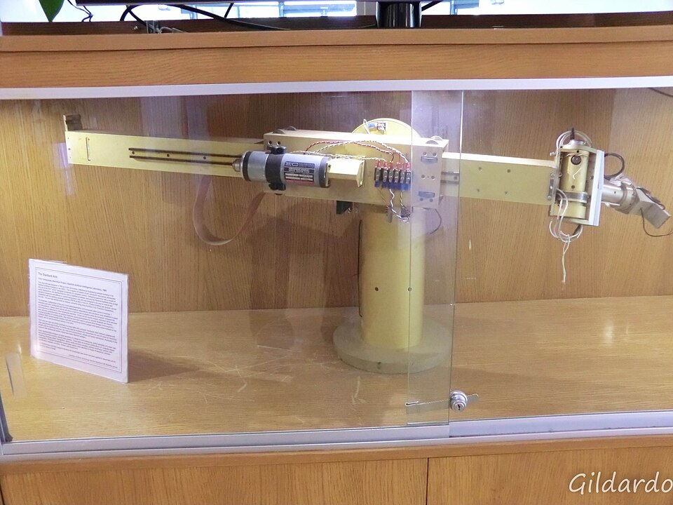  
*The Stanford Arm (1969), the first electric, computer-controlled six-axis robot arm. Image: Gildardo Sánchez, [Wikimedia Commons](https://commons.wikimedia.org/wiki/File:The_Stanford_Arm.jpg), [CC BY 2.0](https://creativecommons.org/licenses/by/2.0/).*

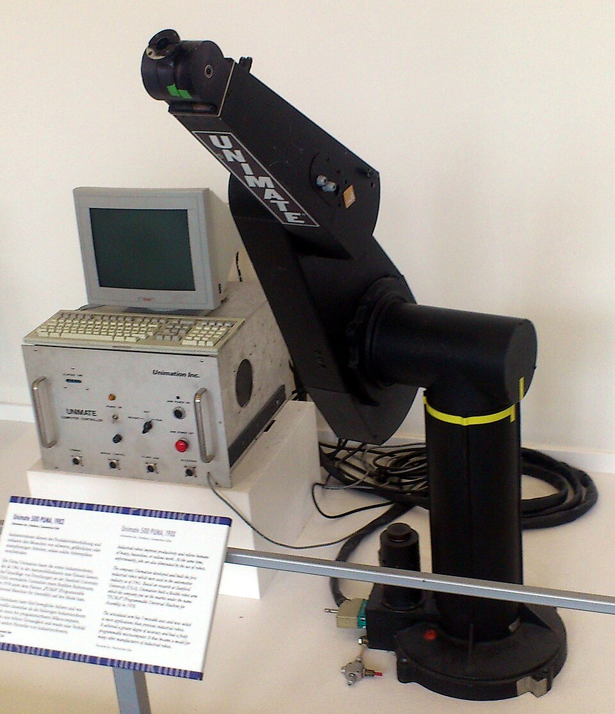  
*A Unimate PUMA 500 (1983) with its controller and computer terminal, on display at the Deutsches Museum in Munich. Image: Theoprakt, [Wikimedia Commons](https://commons.wikimedia.org/wiki/File:Unimate_500_PUMA_Deutsches_Museum.jpg), [CC BY-SA 3.0](https://creativecommons.org/licenses/by-sa/3.0/).*

### C. Commercial & Transportation Automation (Autopilots & Self-Driving Cars)
* **Aircraft Autopilots:**
  * **Sperry Gyroscope Autopilot (1912–1914):** Lawrence Sperry demonstrated the first aircraft autopilot using gyroscopes connected to hydraulic flight controls to maintain straight and level flight without pilot input.
    * *Source:* [Wikipedia – Lawrence Sperry](https://en.wikipedia.org/wiki/Lawrence_Sperry)
  * **Modern Avionics & Autoland:** Evolution from simple mechanical feedback loops to triple-redundant fly-by-wire computers capable of automated takeoff, waypoint navigation, and zero-visibility landings.
    * *Source:* [NASA APPEL – The Digital Fly-By-Wire Program Revolutionized Flight](https://appel.nasa.gov/2016/05/16/this-month-in-nasa-history-the-digital-fly-by-wire-program-revolutionized-flight/)
* **Early Mobile & Commercial Robots:**
  * **Shakey the Robot (1966–1972):** Built at SRI International; the first mobile robot able to perceive its surroundings and reason about its own actions (using the STRIPS planner and A* search algorithm).
    * *Source:* [SRI International – Shakey the Robot](https://www.sri.com/hoi/shakey-the-robot/)
    * *Video:* [SRI – Shakey the Robot: The First Robot to Embody Artificial Intelligence (5:39)](https://www.youtube.com/watch?v=7bsEN8mwUB8)
* **Autonomous Vehicles (Self-Driving Cars):**
  * **ALVINN (1989):** Carnegie Mellon University's Navlab used an early neural network to steer a van across the country.
    * *Source:* [Pomerleau (NeurIPS 1990) – Rapidly Adapting Artificial Neural Networks for Autonomous Navigation](https://proceedings.neurips.cc/paper/1990/hash/248e844336797ec98478f85e7626de4a-Abstract.html)
    * *Video:* [CMU Robotics Institute – NavLab 1 (1986) (2:04)](https://www.youtube.com/watch?v=ntIczNQKfjQ)
  * **DARPA Grand Challenges (2004, 2005, 2007):** Catalyzed modern self-driving technology. Stanford's "Stanley" won the 2005 desert race using LiDAR, GPS, and probabilistic machine learning; CMU's "Boss" won the 2007 Urban Challenge.
    * *Source:* [DARPA – The Grand Challenge](https://www.darpa.mil/about/innovation-timeline/grand-challenge)
    * *Video:* [DARPA Grand Challenge – Stanley Wins (1:36)](https://www.youtube.com/watch?v=LZ3bbHTsOL4)
  * **Commercial Robotaxis & Logistics:** Modern commercial deployments by Waymo (autonomous ride-hailing) and Amazon Robotics (formerly Kiva Systems, automating warehouse fulfillment centers).
    * *Source:* [Waymo – The Waymo Driver](https://waymo.com/waymo-driver/) | [Amazon – Introducing Vulcan (750,000+ robots deployed)](https://www.aboutamazon.com/news/operations/amazon-vulcan-robot-pick-stow-touch)
    * *Video:* [The Verge – I Took a Ride in Waymo's Fully Driverless Car (7:26)](https://www.youtube.com/watch?v=__EoOvVkEMo) | [FORA.tv – A Day in the Life of a Kiva Robot (3:35)](https://www.youtube.com/watch?v=6KRjuuEVEZs) | [Amazon News – Meet Amazon's First Fully Autonomous Mobile Robot (1:44)](https://www.youtube.com/watch?v=AmmEbYkYfHY)

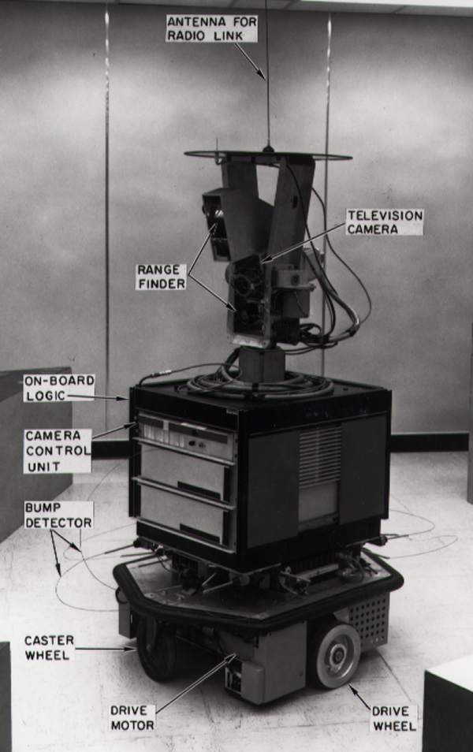  
*Shakey the Robot, with its camera, range finder, bump sensors, and radio antenna labeled. Image: SRI International, [Wikimedia Commons](https://commons.wikimedia.org/wiki/File:SRI_Shakey_with_callouts.jpg), [CC BY-SA 3.0](https://creativecommons.org/licenses/by-sa/3.0/).*

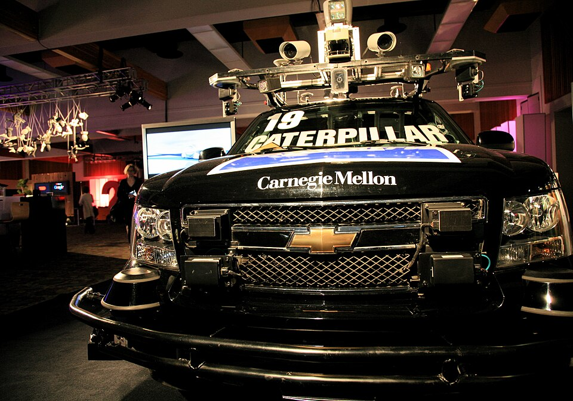  
*"Boss," Carnegie Mellon's winning car in the 2007 DARPA Urban Challenge. The spinning sensors on the roof are LiDAR. Image: Steve Jurvetson, [Wikimedia Commons](https://commons.wikimedia.org/wiki/File:CMU_carbot_(2328347458).jpg), [CC BY 2.0](https://creativecommons.org/licenses/by/2.0/).*

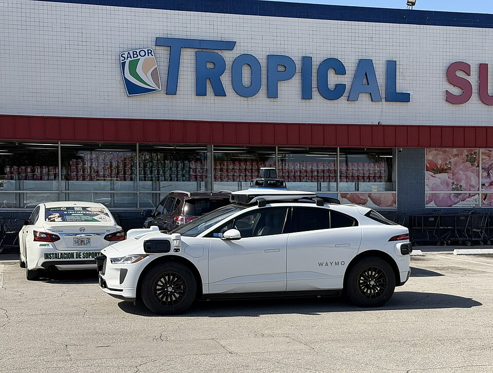  
*A Waymo robotaxi on the road in Miami. Image: Phillip Pessar, [Wikimedia Commons](https://commons.wikimedia.org/wiki/File:Waymo_Self_Driving_Car_in_West_Miami.jpg), [CC BY 4.0](https://creativecommons.org/licenses/by/4.0/).*

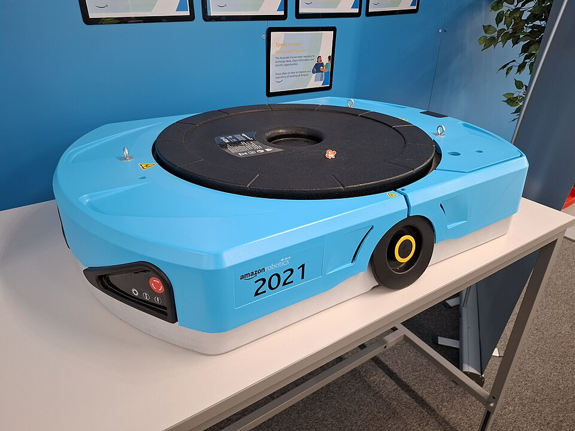  
*An Amazon drive unit (descended from Kiva Systems robots), which carries shelves of goods to human pickers. Image: Auledas, [Wikimedia Commons](https://commons.wikimedia.org/wiki/File:BRS2_Amazon_fulfilment_centre_drive_unit_robot.jpg), [CC BY 4.0](https://creativecommons.org/licenses/by/4.0/).*

### D. Military & Space Robotics
* **Unmanned Aerial Vehicles (UAVs / Drones):**
  * Evolved from early radio-controlled target drones (like the 1930s British "Queen Bee") into modern high-altitude reconnaissance and strike platforms (e.g., MQ-9 Reaper) and small autonomous tactical quadcopters.
  * *Source:* [Imperial War Museums – A Brief History of Drones](https://www.iwm.org.uk/history/contemporary-conflict/a-brief-history-of-drones)
* **Ground Disposal & Legged Systems:**
  * **PackBot (iRobot, 2001+):** Deployed for Explosive Ordnance Disposal (EOD), bomb reconnaissance, and search-and-rescue (including at Ground Zero in 2001 and the Fukushima nuclear plant in 2011).
  * **Boston Dynamics (BigDog, Spot, Atlas):** Originally funded by DARPA to create dynamic, rough-terrain legged robots capable of maintaining balance under heavy loads.
  * *Source:* [IEEE Spectrum – iRobot PackBot](https://robotsguide.com/robots/packbot) | [Boston Dynamics – About & History](https://bostondynamics.com/about/)
  * *Video:* [Teledyne FLIR – PackBot 510 (3:02)](https://www.youtube.com/watch?v=kV0GwG269xQ) | [Boston Dynamics – BigDog Overview (3:25)](https://www.youtube.com/watch?v=cNZPRsrwumQ) | [Boston Dynamics – Spot Launch (2:01)](https://www.youtube.com/watch?v=wlkCQXHEgjA)
* **Planetary Exploration (Space Rovers):**
  * Because radio signals take between 5 and 20 minutes to reach Mars, NASA rovers (*Sojourner*, *Spirit*, *Opportunity*, *Curiosity*, and *Perseverance*) rely on onboard autonomous navigation software (AutoNav) to identify hazards and plot safe paths without real-time human joysticks.
  * *Source:* [NASA JPL – Perseverance Rover Autonomous Navigation](https://science.nasa.gov/mission/mars-2020-perseverance/rover-components/#autonav)
  * *Video:* [NASA – Perseverance Rover's Descent and Touchdown on Mars (3:25)](https://www.youtube.com/watch?v=4czjS9h4Fpg)

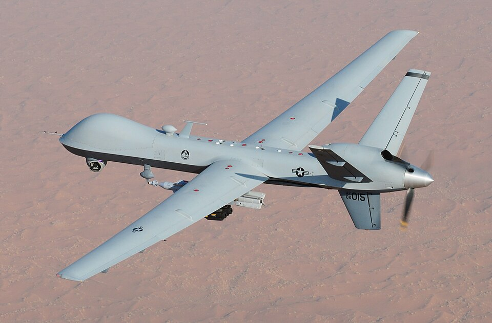  
*An MQ-9 Reaper unmanned aerial vehicle. Image: U.S. Air Force photo, Lt. Col. Leslie Pratt, [Wikimedia Commons](https://commons.wikimedia.org/wiki/File:MQ-9_Reaper_UAV_(cropped).jpg), public domain.*

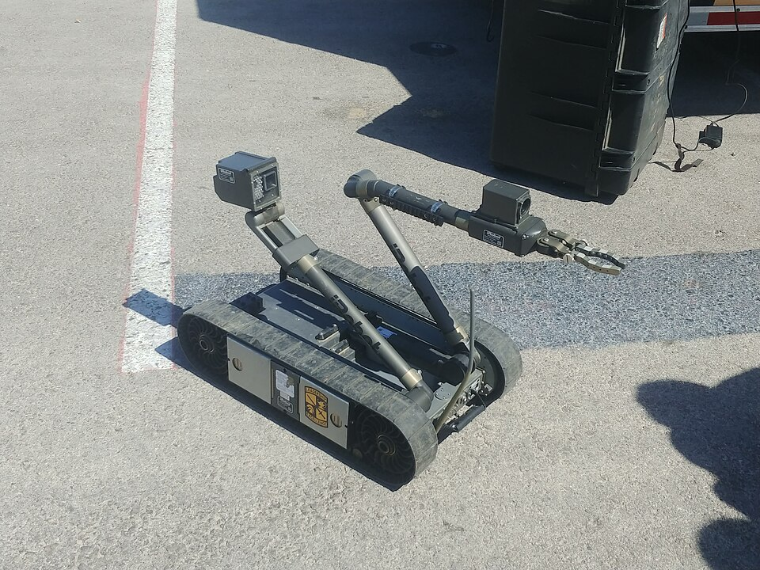  
*An iRobot 510 PackBot with its manipulator arm. Image: Noah Wulf, [Wikimedia Commons](https://commons.wikimedia.org/wiki/File:IRobot_510_PackBot_-_2022_STEM_Event.jpg), [CC BY-SA 3.0](https://creativecommons.org/licenses/by-sa/3.0/).*

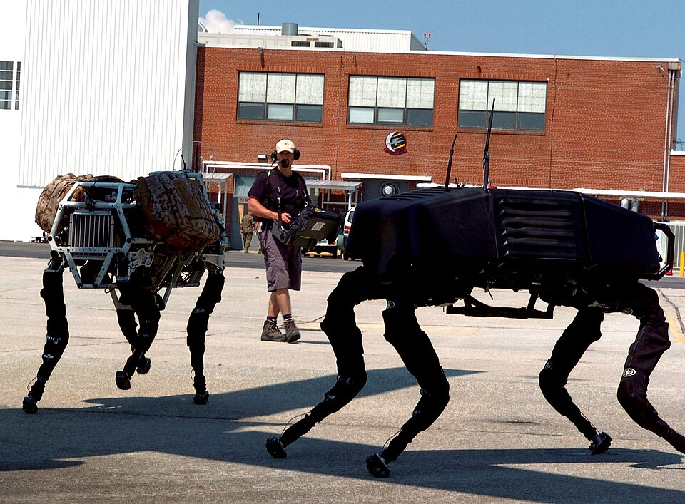  
*Two Boston Dynamics BigDog robots being tested by the U.S. Marine Corps. Image: U.S. Marine Corps photo, Lance Cpl. M. L. Meier, [Wikimedia Commons](https://commons.wikimedia.org/wiki/File:Big_dog_military_robots.jpg), public domain.*

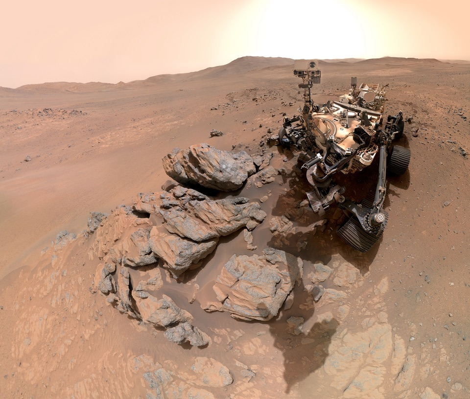  
*A self-portrait taken by NASA's Perseverance rover on Mars. Image: NASA/JPL-Caltech/MSSS, [Wikimedia Commons](https://commons.wikimedia.org/wiki/File:Perseverance_Stuns_in_New_Selfie.png), public domain.*

### E. Home & Consumer Robotics
* **Domestic Cleaning Robots:**
  * **iRobot Roomba (2002):** Brought autonomous robotics into millions of homes. Early generations relied on simple reactive bump-and-turn algorithms; modern versions build complete floor plans using LiDAR and camera-based SLAM (Simultaneous Localization and Mapping).
  * *Source:* [IEEE Spectrum ROBOTS Guide – Roomba](https://robotsguide.com/robots/roomba)
* **Entertainment, Companion, and Lawn Care Robots:**
  * **Sony AIBO (1999):** Robotic pet dog designed to learn and mature through human interaction.
  * **Paro:** Therapeutic robotic baby harp seal used in hospitals and eldercare facilities to reduce patient anxiety.
  * **Robotic Lawn Mowers & Pool Cleaners:** Widespread consumer adoption of perimeter-guided and GPS-guided yard maintenance systems.
  * *Source:* [IEEE Spectrum – Sony AIBO & Consumer Robotics](https://robotsguide.com/robots/aibo) | [PARO Therapeutic Robot](http://www.parorobots.com/)

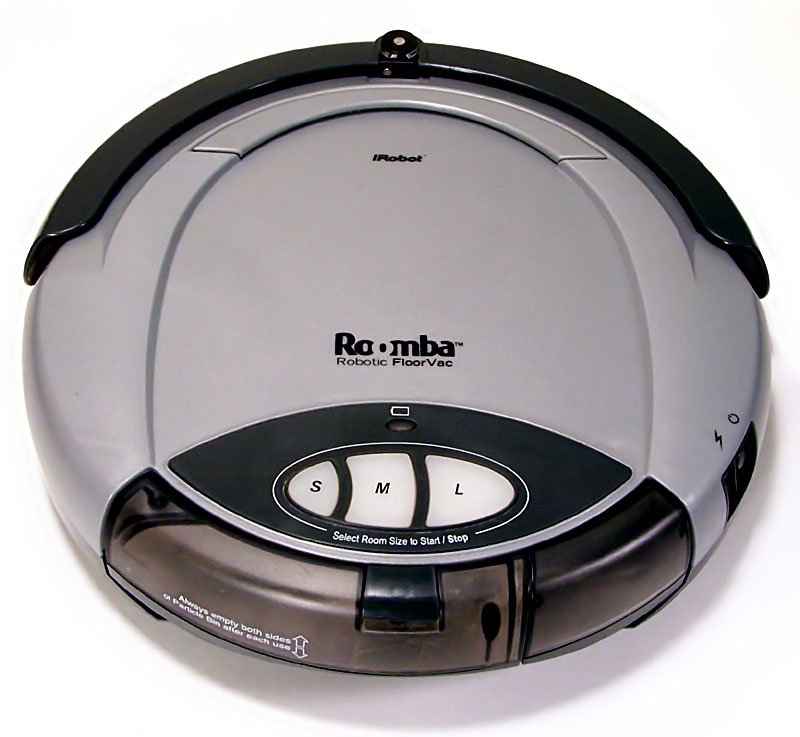  
*A first-generation Roomba (2002). Image: Larry D. Moore, [Wikimedia Commons](https://commons.wikimedia.org/wiki/File:Roomba_original.jpg), [CC BY 4.0](https://creativecommons.org/licenses/by/4.0/).*

  
*PARO, the therapeutic robot baby harp seal. Image: Tekniska museet/Peter Häll, [Wikimedia Commons](https://commons.wikimedia.org/wiki/File:Robots%C3%A4len_Paro_TEKS0057912.jpg), [CC BY-SA 4.0](https://creativecommons.org/licenses/by-sa/4.0/).*

### F. Humanoid Robots
* **Why Build a Robot Shaped Like a Person?**
  * Our homes, factories, stairs, doors, and tools are all designed for human bodies. A robot with two legs, two arms, and hands could, in principle, work in those places without anyone redesigning them.
  * Humanoids are also very hard to build. Balancing on two legs and handling objects with hands are classic examples of Moravec's Paradox (see Section 3B).
* **Early Research Humanoids:**
  * **WABOT-1 (1973):** Built by Ichiro Kato's team at Waseda University in Japan, it is widely considered the first full-scale humanoid robot. It could walk on two legs, grip objects, and speak simple Japanese; its builders compared its abilities to those of a 1½-year-old child.
    * *Source:* [Waseda University – The Robots of Waseda: A 50-Year Journey in Humanoid Innovation](https://www.waseda.jp/top/en/news/88080)
  * **Honda ASIMO (2000–2022):** Became the world's best-known humanoid by walking smoothly, running, and climbing stairs in public demonstrations. Honda stopped developing ASIMO in 2018 and retired it in 2022.
    * *Source:* [IEEE Spectrum ROBOTS Guide – ASIMO](https://robotsguide.com/robots/asimo)
    * *Video:* [Honda ASIMO Humanoid Robot (2011 demonstration) (2:20)](https://www.youtube.com/watch?v=1V9XUMCPGF8)
* **Social Humanoids (Robots Built to Talk With People):**
  * **Sophia (Hanson Robotics, 2016):** A robot with a lifelike human face that debuted at the South by Southwest festival in 2016. In 2017, Saudi Arabia granted Sophia citizenship, making it the first robot to be given citizenship by any country. Critics called this a publicity stunt, since officials never said what rights a robot citizen would actually have.
  * **Is Sophia intelligent?** Much of what Sophia says comes from pre-written responses, which can create an illusion that it understands the conversation. In 2018, AI researcher Yann LeCun (whose CNNs we studied) publicly criticized the way Sophia was presented as misleading.
    * *Source:* [Live Science – Lifelike 'Sophia' Robot Granted Citizenship to Saudi Arabia](https://www.livescience.com/60815-saudi-arabia-citizen-robot.html) | [Wikipedia – Sophia (robot)](https://en.wikipedia.org/wiki/Sophia_(robot))
    * *Video:* [The Tonight Show – Jimmy Meets Sophia the Human-Like Robot (8:04)](https://www.youtube.com/watch?v=Bg_tJvCA8zw)
  * **Ameca (Engineered Arts, 2021):** A humanoid with a gray, deliberately robotic-looking face that can make very realistic expressions. It is often connected to a large language model (LLM) so it can hold open-ended conversations.
    * *Source:* [Engineered Arts – Ameca](https://engineeredarts.com/robot/ameca/)
    * *Video:* [Engineered Arts – Ameca Humanoid Robot AI Platform (0:42)](https://www.youtube.com/watch?v=IPukuYb9xWw)
* **Humanoids for Work (2020s):**
  * **Boston Dynamics Atlas:** The original hydraulic Atlas was developed with DARPA funding and used by many teams in the 2013–2015 DARPA Robotics Challenge, and later became famous for videos of it doing parkour and backflips. In 2024, Boston Dynamics replaced it with a fully electric Atlas. In 2026, Hyundai (Boston Dynamics' majority owner) announced plans to use Atlas in its electric-vehicle factory near Savannah, Georgia, by 2028.
    * *Source:* [Boston Dynamics – Atlas](https://bostondynamics.com/atlas/) | [NBC News – Hyundai and Boston Dynamics Unveil Humanoid Robot Atlas at CES](https://www.nbcnews.com/tech/tech-news/hyundai-boston-dynamics-unveil-humanoid-robot-atlas-ces-rcna252483)
    * *Video:* [Boston Dynamics – Atlas: Partners in Parkour (1:06)](https://www.youtube.com/watch?v=tF4DML7FIWk) | [Boston Dynamics – All New Atlas (0:39)](https://www.youtube.com/watch?v=29ECwExc-_M) | [Boston Dynamics – Do You Love Me? (Atlas, Spot, and Handle dancing) (2:55)](https://www.youtube.com/watch?v=fn3KWM1kuAw)
  * **Tesla Optimus:** Announced at Tesla's AI Day in 2021, with a working prototype shown in 2022. At Tesla's "We, Robot" event in October 2024, Optimus robots served drinks and chatted with guests, but they were mostly remote-controlled by humans (teleoperated), and Tesla was criticized for not making that clear. In 2026, Tesla was reported to be building Optimus robots in the hundreds per week for use in its own factories, but the robots still struggled to handle tasks they hadn't been specifically trained for, and they are not for sale.
    * *Source:* [Wikipedia – Optimus (robot)](https://en.wikipedia.org/wiki/Optimus_(robot)) | [Electrek – Tesla Ramps Optimus to Hundreds a Week, but the Robots Can't Generalize](https://electrek.co/2026/09/25/tesla-optimus-production-ramp-hands-ai-generalization-problems/)
    * *Video:* [Tesla – Optimus Gen 2 (1:43)](https://www.youtube.com/watch?v=cpraXaw7dyc)
  * **Other Humanoids at Work:**
    * **Figure AI:** In 2024, BMW tested Figure's humanoid robots placing sheet-metal parts at its car plant in Spartanburg, South Carolina.
    * **Agility Robotics Digit:** In 2024, the logistics company GXO signed the first multi-year commercial agreement to rent humanoid robots, using Digit to move bins (totes) onto conveyor belts in its warehouses.
    * **Unitree (China):** Sells comparatively low-cost humanoids such as the G1, putting humanoid robots within reach of universities and research labs.
    * *Source:* [BMW Group – Successful Test of Humanoid Robots at BMW Group Plant Spartanburg](https://www.press.bmwgroup.com/portugal/article/detail/T0444274PT/successful-test-of-humanoid-robots-at-bmw-group-plant-spartanburg) | [Agility Robotics – GXO Signs Industry-First Multi-Year Agreement](https://agilityrobotics.com/content/gxo-signs-industry-first-multi-year-agreement-with-agility-robotics) | [Unitree – G1](https://www.unitree.com/g1/)
    * *Video:* [Figure – Introducing Figure 02 (2:03)](https://www.youtube.com/watch?v=0SRVJaOg9Co) | [Agility Robotics – Digit Gets to Work at GXO (2:17)](https://www.youtube.com/watch?v=NgYo-Wd0E_U) | [Unitree – Introducing the Unitree G1 Humanoid (1:44)](https://www.youtube.com/watch?v=GzX1qOIO1bE)
* **Connection to AI Concepts:** Today's humanoids learn to walk using reinforcement learning in simulation (Sim-to-Real, Section 2C), and many are being trained to follow spoken instructions using Vision-Language-Action models (Section 2D).

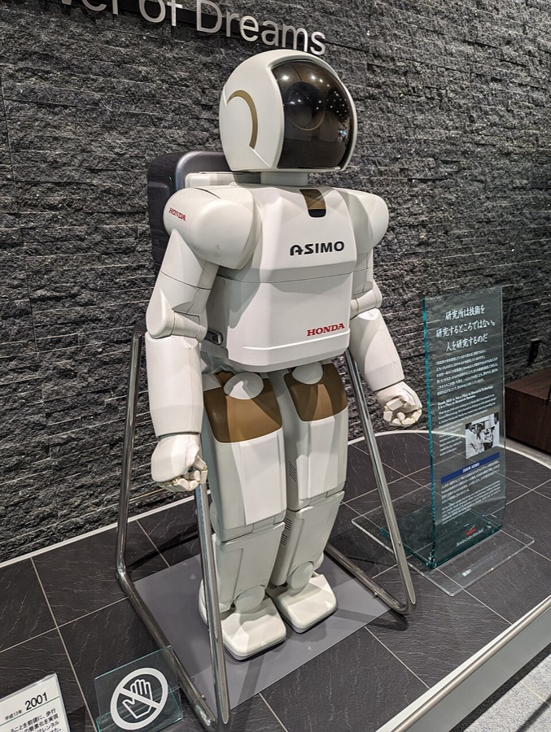  
*Honda's ASIMO on display at the Honda Collection Hall in Japan. Image: Syced, [Wikimedia Commons](https://commons.wikimedia.org/wiki/File:Asimo_at_Honda_Collection_Hall.jpg), public domain (CC0).*

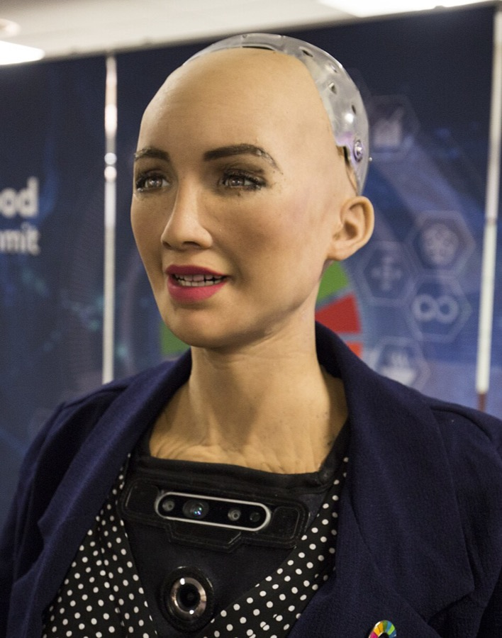  
*Sophia at the AI for Good Global Summit in Geneva, 2018. Image: ITU Pictures, [Wikimedia Commons](https://commons.wikimedia.org/wiki/File:Sophia_at_the_AI_for_Good_Global_Summit_2018_(27254369347)_(cropped).jpg), [CC BY 2.0](https://creativecommons.org/licenses/by/2.0/).*

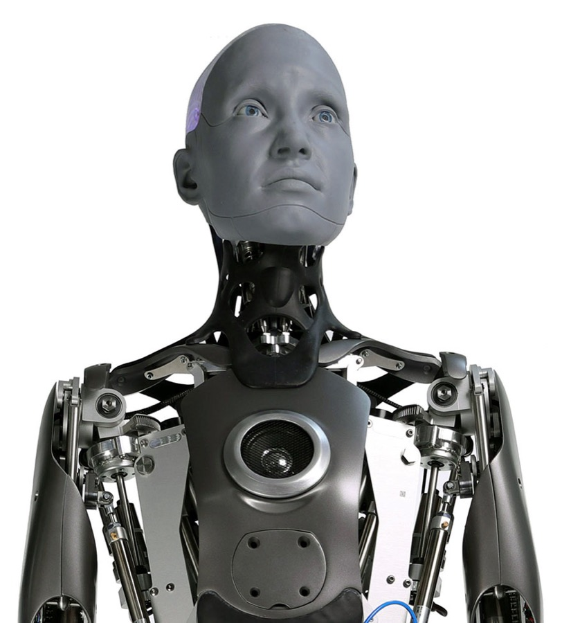  
*An early version of Ameca in the Engineered Arts lab. Image: Willy Jackson, [Wikimedia Commons](https://commons.wikimedia.org/wiki/File:Ameca_Generation_1.jpg), [CC BY-SA 4.0](https://creativecommons.org/licenses/by-sa/4.0/).*

*"Helios," a hydraulic Atlas robot programmed by an MIT team, working through a simulated disaster course at the 2015 DARPA Robotics Challenge. Image: U.S. Navy photo, John Williams, [Wikimedia Commons](https://commons.wikimedia.org/wiki/File:2015_DARPA_Robotics_Challenge_150606-N-PO203-834.jpg), public domain.*

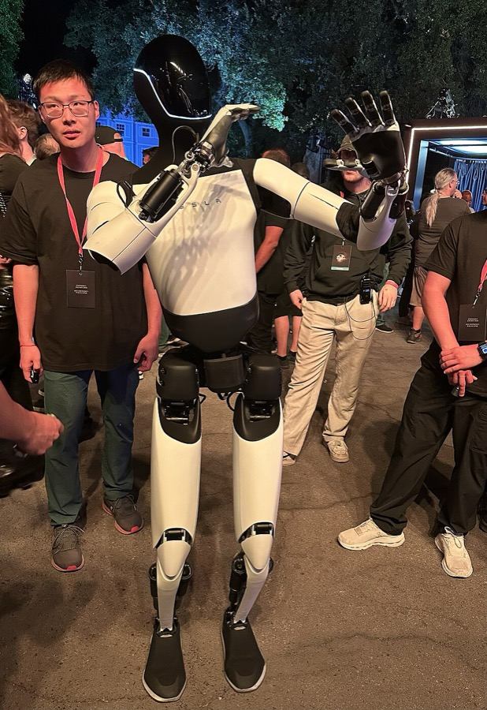  
*A Tesla Optimus robot among guests at Tesla's "We, Robot" event in October 2024. Image: Steve Jurvetson, [Wikimedia Commons](https://commons.wikimedia.org/wiki/File:Latest_Tesla_Optimus_Humanoid_Robot.jpg), [CC BY 2.0](https://creativecommons.org/licenses/by/2.0/).*

---

## 2. Types of AI Systems Used in Robotics

Modern robots rarely rely on a single AI algorithm; instead, they combine multiple paradigms we have studied this term into a layered architecture (**Sense &rightarrow; Plan &rightarrow; Act**).

### A. Symbolic AI (GOFAI) in Robotics
* **State-Space Search (Pathfinding):**
  * Just as we used **Breadth-First Search (BFS)** to solve river-crossing puzzles, mobile robots represent physical maps as grids or graphs (states and transitions).
  * Robots use graph-search algorithms (like BFS, Dijkstra's algorithm, and **A* Search**) to calculate the shortest collision-free route from Point A to Point B.
  * *Source:* [Red Blob Games (Amit Patel) – Introduction to the A* Algorithm](https://www.redblobgames.com/pathfinding/a-star/introduction.html)
* **Game Trees and Minimax (Planning Against an Opponent):**
  * Just as we built a **game tree** for tic-tac-toe and used the **minimax algorithm** to choose the best move (assuming the opponent also plays their best), a robot that plays a game against a person, such as a robot arm playing chess or tic-tac-toe, uses a game tree to decide its next move. It then uses its camera to see the board and its arm to move the piece.
  * In fast-moving, real-world contests like robot soccer (RoboCup), there are far too many possible moves to build a complete game tree, so robots look only a few moves ahead and combine that with rules and learned strategies.
  * *Source:* [Elements of AI – Ch. 2, Search and Games](https://course.elementsofai.com/2/3) | [RoboCup Federation](https://www.robocup.org/)
* **Rule-Based Systems & Finite State Machines:**
  * Hardcoded `IF...THEN` production rules are critical for **safety interlocks** and deterministic control (e.g., `IF proximity_sensor < 0.5m THEN apply_emergency_brake = true`).
  * *Source:* [ROS (Robot Operating System) – Behavior Trees and State Machines](https://www.behaviortree.dev/)

### B. Traditional Machine Learning (Statistical & Classical ML)
* **Bayes' Rule (Probabilistic Localization & Sensor Fusion):**
  * Real-world robot sensors (wheel odometers, GPS, sonar, LiDAR) are noisy and imperfect.
  * Robots use **Bayes' Rule** (*Posterior odds = Prior odds &times; Likelihood ratio*) to continuously update their belief about where they are on a map:
    * **Prior Odds:** Where the robot *thinks* it is based on its last known position and wheel rotations.
    * **Likelihood Ratio:** New evidence coming in from laser rangefinders or cameras.
    * **Posterior Odds:** The updated, more accurate probability distribution of the robot's exact location (used in **Kalman Filters** and **Particle Filters / Monte Carlo Localization**).
  * *Source:* [Probabilistic Robotics (Thrun, Burgard & Fox) – Book Website](https://robots.stanford.edu/probabilistic-robotics/)
* **Regression (Linear & Logistic):**
  * **Linear Regression:** Used for sensor calibration, predicting battery depletion rates based on payload weight, and estimating braking distances based on velocity.
  * **Logistic Regression:** Used for binary classification tasks, such as predicting the probability of wheel slip on wet terrain or predicting whether a mechanical joint is about to fail (predictive maintenance).
  * *Source:* [Towards Data Science – Machine Learning in Robotics](https://towardsdatascience.com/)
* **K-Nearest Neighbors (K-NN) & Decision Trees / Random Forests:**
  * **K-NN:** Used in 3D LiDAR point-cloud processing to cluster nearby laser reflections together to identify distinct physical objects.
  * **Decision Trees & Random Forests:** Used to classify terrain types (e.g., grass vs. gravel vs. pavement) based on vibration and torque features so a legged or wheeled robot can adjust its gait or speed.
  * *Source:* [IEEE Xplore – Terrain Classification for Mobile Robots using Random Forests](https://ieeexplore.ieee.org/)

### C. Artificial Neural Networks (Connectionism) & Reinforcement Learning
* **Convolutional Neural Networks (CNNs) for Computer Vision:**
  * Building on Yann LeCun's CNNs and Fei-Fei Li's ImageNet, robots use deep neural networks to process camera feeds in real time—identifying pedestrians, reading street signs, and detecting grasp points on irregular objects on a conveyor belt.
  * *Source:* [NVIDIA – Deep Learning for Robot Perception](https://developer.nvidia.com/isaac)
* **Reinforcement Learning (RL) for Motor Control:**
  * Instead of programmers manually coding the physics for how a two-legged robot walks over slippery rocks, the robot learns via **trial-and-error** in a physics simulator, receiving positive rewards for moving forward without falling.
  * Once trained in simulation over millions of virtual hours, the neural network policy is transferred to the physical robot (**Sim-to-Real** transfer).
  * *Source:* [ETH Zurich Robotic Systems Lab – Learning Agile Walk via Reinforcement Learning](https://rsl.ethz.ch/)
  * *Video:* [ETH Zürich – ANYmal Can Do Parkour and Walk Across Rubble (0:59)](https://www.youtube.com/watch?v=REvNnUzVDAA)

### D. Generative AI & Foundation Models in Robotics
* **Natural Language Human-Robot Interaction:**
  * Instead of writing complex code or using a teach pendant, factory workers can give spoken or typed instructions to a robot (similar to Terry Winograd's 1971 SHRDLU, but in the messy real world!) using Large Language Models (LLMs).
* **Vision-Language-Action (VLA) Models:**
  * Models like **Google DeepMind's RT-2 (Robotic Transformer 2)** and Gemini Robotics combine visual perception, natural language reasoning, and robotic motor control into a single generative model.
  * *Example:* If you tell a robot *"Pick up the extinct animal"* from a table holding a plastic dinosaur, a toy car, and an apple, the VLA model uses its web-pretrained knowledge to identify the dinosaur and generates the motor commands to pick it up.
  * *Source:* [Google DeepMind – RT-2: Vision-Language-Action Models](https://deepmind.google/discover/blog/rt-2-new-model-translates-vision-and-language-into-action/) | [Physical Intelligence (&pi;0) – Generalist Robot Policies](https://www.pi.website/)
  * *Video:* [Google DeepMind – Gemini Robotics: Bringing AI to the Physical World (3:00)](https://www.youtube.com/watch?v=4MvGnmmP3c0)

---

## 3. Advantages and Disadvantages of Robotics and Automation

### A. Advantages
1. **Labor Saving & Productivity (Primary Advantage):**
   * Robots operate 24/7/365 without fatigue, breaks, vacations, or shift changes, dramatically increasing manufacturing throughput and lowering the per-unit cost of goods.
   * *Source:* [Brookings Institution – Automation and Artificial Intelligence: How Machines Are Affecting People and Places](https://www.brookings.edu/articles/automation-and-artificial-intelligence-how-machines-affect-people-and-places/)
2. **Safety in "4D" Environments (Dull, Dirty, Dangerous, and Dear):**
   * Removes humans from hazardous environments: toxic paint booths, semiconductor cleanrooms, deep-sea oil rigs, bomb disposal, nuclear cleanup (Fukushima), and space exploration.
   * Reduces repetitive strain injuries (RSIs) and workplace accidents in heavy lifting.
   * *Source:* [OSHA – Robotics and Workplace Safety](https://www.osha.gov/robotics)
3. **Precision, Consistency, and Quality Control:**
   * Industrial and surgical robots (such as the **da Vinci Surgical System**) operate with sub-millimeter repeatability, eliminating human hand tremor and reducing manufacturing defect rates.
   * *Source:* [National Institutes of Health (NIH) – Robotic Surgery Precision and Outcomes](https://pmc.ncbi.nlm.nih.gov/)
   * *Video:* [Da Vinci Surgery – da Vinci Robot Stitches a Grape Back Together (1:47)](https://www.youtube.com/watch?v=0XdC1HUp-rU)
4. **Addressing Demographic Labor Shortages:**
   * Helps countries with aging populations and shrinking workforces (e.g., Japan, South Korea, parts of Europe) maintain economic output and provide eldercare assistance.
   * *Source:* [World Economic Forum – How Automation Can Solve Labor Shortages](https://www.weforum.org/)

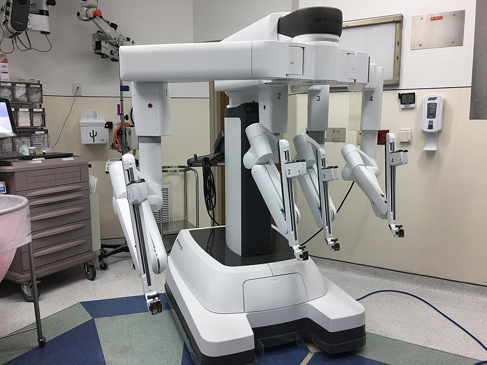  
*A da Vinci Xi surgical robot. The surgeon controls the arms from a separate console. Image: Alvarogarciamd, [Wikimedia Commons](https://commons.wikimedia.org/wiki/File:New_Da_Vinci_Xi.jpg), [CC BY-SA 4.0](https://creativecommons.org/licenses/by-sa/4.0/).*

### B. Disadvantages
1. **Job Displacement & Technological Unemployment (Primary Disadvantage):**
   * Direct replacement of routine, manual, and assembly-line workers, often devastating localized manufacturing communities ("Rust Belt" effects) and hollowing out middle-skill blue-collar wages.
   * Economists Daron Acemoglu and Pascual Restrepo found that adding one industrial robot per 1,000 workers in the U.S. reduced the local employment-to-population ratio by 0.2% and depressed wages by 0.42%.
   * *Source:* [MIT / NBER (Acemoglu & Restrepo) – Robots and Jobs: Evidence from US Labor Markets](https://www.nber.org/papers/w23285)
2. **High Capital Costs & Economic Inequality:**
   * Purchasing, integrating, and maintaining robotic systems requires massive upfront capital investment, giving huge corporations an advantage over small- and medium-sized businesses and concentrating wealth among capital owners rather than labor.
   * *Source:* [International Monetary Fund (IMF) Blog – Robots, Growth, and Inequality](https://www.imf.org/en/blogs/articles/2016/09/07/robots-growth-inequality)
3. **Brittleness & Lack of Adaptability ("Moravec's Paradox"):**
   * **Moravec's Paradox:** High-level reasoning (playing chess, solving calculus) requires very little computation for a computer, but low-level sensorimotor skills (folding a crumpled towel, picking a ripe strawberry without bruising it) are extraordinarily difficult for robots.
   * Traditional industrial robots often break down or halt production if a part is slightly misaligned.
   * *Source:* [Stanford AI100 – Moravec's Paradox and Robotics Challenges](https://ai100.stanford.edu/)
4. **Cybersecurity, Safety, and Ethical Liabilities:**
   * Connected robots and autonomous vehicles are vulnerable to hacking or sensor spoofing.
   * Legal and ethical ambiguity: When a self-driving car or autonomous weapon causes harm, who is legally liable—the owner, the software engineer, or the manufacturer?
   * *Source:* [Pew Research Center – Americans Cautious About the Deployment of Driverless Cars](https://www.pewresearch.org/internet/2022/03/17/americans-cautious-about-the-deployment-of-driverless-cars/)

---

## 4. Industrial Automation vs. Generative AI: From Blue-Collar to White-Collar Disruption

### A. The Industrial Wave: Physical Automation & "Dark Factories"
* **How Robotics Replaced Factory Workers:**
  * Beginning in the 1970s and accelerating in the 1990s–2020s, industrial automation targeted **routine physical labor** (welding, painting, stamping, palletizing, and warehousing).
  * A modern car plant that once required thousands of assembly-line workers now operates with a fraction of the human workforce, mostly overseeing robotic cells.
* **The Rise of "Dark Factories" (Lights-Out Manufacturing):**
  * **"Lights-Out" or "Dark" Factories** are manufacturing facilities so completely automated that they require zero human presence on the factory floor—meaning they can literally operate in the dark with the lights turned off and without heating or air conditioning.
  * **Real-World Examples:**
    * **FANUC (Japan):** Runs a famous "lights-out" factory where industrial robots build other industrial robots 24 hours a day, unsupervised for up to 30 days at a time.
    * **Xiaomi (China, 2023–2024):** Opened a dark factory in Changping capable of producing over 10 million flagship smartphones per year (one phone every second) with autonomous micron-level assembly and self-diagnosing AI software—no human assembly workers on the floor.
    * **Philips (Netherlands):** Produces electric shavers in a nearly dark factory using 128 robots, requiring only a handful of human quality-control engineers.
  * *Source:* [IEEE Spectrum – Inside FANUC's Lights-Out Factory](https://spectrum.ieee.org/) | [World Economic Forum – Lights-Out Manufacturing and Smart Factories](https://www.weforum.org/)
  * *Video:* [FANUC – Robots Assemble Their Own Motors (2:33)](https://www.youtube.com/watch?v=bQ-YkFzWj6o)

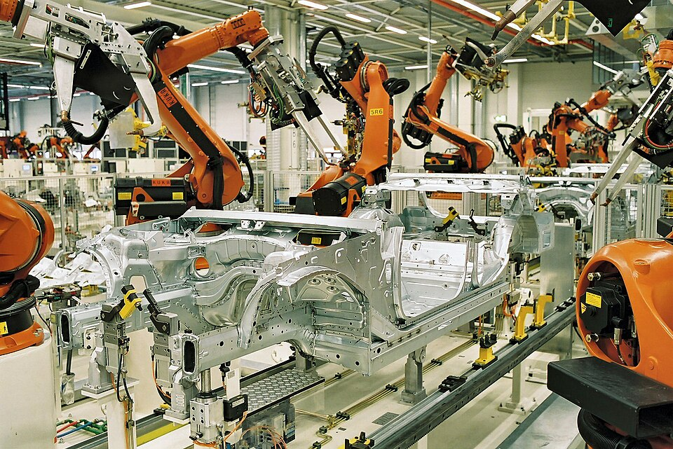  
*KUKA robots spot-welding car bodies at BMW's plant in Leipzig, Germany, with no workers on the line. Image: BMW Werk Leipzig, [Wikimedia Commons](https://commons.wikimedia.org/wiki/File:BMW_Leipzig_MEDIA_050719_Download_Karosseriebau_max.jpg), [CC BY-SA 2.0 DE](https://creativecommons.org/licenses/by-sa/2.0/de/deed.en).*

### B. The Generative AI Wave: Cognitive Automation ("Digital Dark Factories")
* **The Paradigm Shift:**
  * For decades, conventional wisdom held that automation would replace physical, blue-collar jobs first, followed by routine clerical work, while high-paying, creative, and analytical **white-collar knowledge jobs** (coding, writing, design, marketing) were safe.
  * Generative AI (LLMs, diffusion models, and autonomous coding agents) has flipped this assumption on its head, automating **non-routine cognitive and creative tasks**.
  * *Source:* [OpenAI & University of Pennsylvania – GPTs are GPTs: Labor Market Impact Potential of LLMs](https://arxiv.org/abs/2303.10130)
* **Key Sectors Experiencing Replacement and Transformation Today:**
  1. **Software Development:**
     * AI coding assistants and autonomous software agents (GitHub Copilot, Claude Code, Cursor) can write boilerplate code, generate unit tests, debug errors, and refactor entire repositories.
     * While senior software architects become more productive, companies are reducing hiring for entry-level / junior programmers—mirroring how factories kept senior maintenance engineers while eliminating apprentice assembly jobs.
     * *Source:* [McKinsey – Unleashing Developer Productivity with Generative AI](https://www.mckinsey.com/capabilities/tech-and-ai/our-insights/unleashing-developer-productivity-with-generative-ai)
  2. **Sales, Marketing, and Content Creation:**
     * Generative AI drafts ad copy, generates product photography and promotional video, runs personalized outbound sales emails, and conducts market sentiment analysis—tasks that previously required teams of copywriters, graphic designers, and junior marketers.
     * *Source:* [Harvard Business Review – How Generative AI Could Disrupt Creative Work](https://hbr.org/2023/04/how-generative-ai-could-disrupt-creative-work)
  3. **Customer Service, Legal, and Finance:**
     * Companies like Klarna publicly reported in 2024 that its generative AI customer service assistant was doing the equivalent work of 700 full-time human agents. Paralegals and junior financial analysts face similar disruption in contract review and financial summarization.
     * *Source:* [Goldman Sachs Global Investment Research – The Potentially Large Effects of AI on Economic Growth](https://www.goldmansachs.com/insights/articles/generative-ai-could-raise-global-gdp-by-7-percent.html)

### C. Side-by-Side Comparison: Factory Robotics vs. Generative AI

| Dimension | Industrial Robotics (1960s–Present) | Generative AI & Agents (2022–Present) |
| :--- | :--- | :--- |
| **Target of Automation** | Physical, manual, and routine motor tasks (muscles & dexterity). | Cognitive, analytical, linguistic, and creative tasks (brains & communication). |
| **Primary Workers Affected** | Blue-collar workers (machinists, welders, warehouse pickers, assembly workers). | White-collar knowledge workers (software developers, marketers, paralegals, customer support). |
| **Speed of Deployment** | **Slow:** Requires building expensive physical hardware, retooling factories, and years of capital depreciation. | **Extremely Fast:** Deployed instantly via cloud APIs and software updates using existing computers. |
| **Ultimate Extreme** | **"Dark Factories":** Physical plants producing goods 24/7 with no humans on the floor. | **"Autonomous Digital Enterprises":** Multi-agent software pipelines writing code, running marketing campaigns, and handling support with minimal human oversight. |
| **Human Role Shift** | From *assembling parts* to *monitoring, maintaining, and programming* robotic cells. | From *writing every line of code/copy* to *prompting, orchestrating, and verifying* AI outputs. |

### D. Discussion Questions for Students
1. When industrial robots automated factories, displaced workers were often told to *"learn to code."* Now that Generative AI can write code, what skills should human workers focus on developing?
2. Is a "lights-out" software company (where AI agents manage product development, marketing, and support) realistic, or will symbolic AI's limitations (like the lack of true common sense and LLM hallucinations) always require a "human in the loop"?

---

## Reference

- [International Federation of Robotics (IFR) – History of Industrial Robots](https://ifr.org/robot-history)
- [SRI International – 75 Years of Innovation: Shakey the Robot](https://www.sri.com/hoi/shakey-the-robot/)
- Thrun, Sebastian, Wolfram Burgard, and Dieter Fox. *[Probabilistic Robotics](https://robots.stanford.edu/probabilistic-robotics/)*. MIT Press, 2005.
- Acemoglu, Daron, and Pascual Restrepo. "[Robots and Jobs: Evidence from US Labor Markets](https://www.nber.org/papers/w23285)." *Journal of Political Economy*, vol. 128, no. 6, 2020.
- Eloundou, Tyna, et al. "[GPTs are GPTs: An Early Look at the Labor Market Impact Potential of Large Language Models](https://arxiv.org/abs/2303.10130)." *arXiv preprint*, 2023.
- [World Economic Forum – The Future of Jobs Report](https://www.weforum.org/publications/the-future-of-jobs-report-2023/)
- [Elements of AI](https://www.elementsofai.com/)&mdash;University of Helsinki and MinnaLearn, 2024.

---

 Intro to AI lecture notes by [Brian Bird](https://profbird.dev), written in <time>2026</time>, are licensed under a [Creative Commons Attribution-ShareAlike 4.0 International License](http://creativecommons.org/licenses/by-sa/4.0/). 

