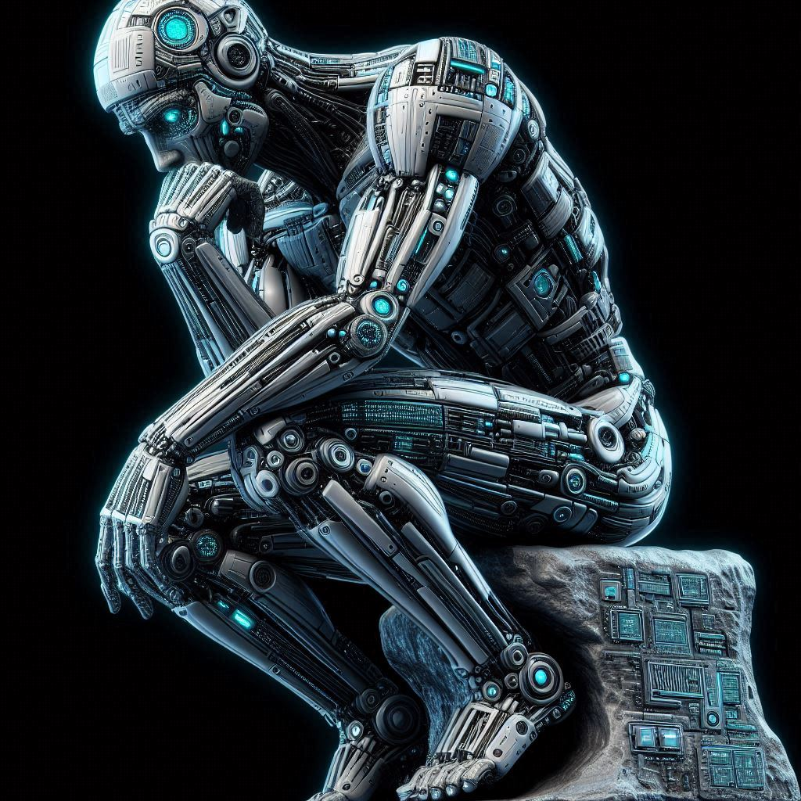

**CS 112, Intro to AI**

<h1>Week 6 Overview for Fall 2026</h1>

<h2>Nov. 2 through Nov. 8</h2>

| Topics                                                       |                                                |
| ------------------------------------------------------------ | ---------------------------------------------- |
| Overview of AI                                               | <mark>Neural networks and deep learning</mark> |
| AI Problem Solving Revisited Machine Learning&mdash;Part 1 Applications of AI | Generative AI + Prompt engineering             |
| Machine Learning&mdash;Part 2                                | Custom chatbot creation                        |
| History of AI, Robotics and Midterm                          | Social and ethical issues of AI   Final   |

## This Week's Learning Objectives

  

    
By the end of this week you will:

    <ul style="margin-bottom: 0;">
      <li>Know how biological neurons and neural networks function.</li>
      <li>Be able to describe how a perceptron (an artificial neuron) works.</li>
      <li>Be able to explain what an artificial neural network (ANN) is and how it can be used.</li>
      <li>Understand deep learning neural networks.</li>
    </ul>
  

  <figure style="position: relative; flex: 0 0 200px; width: 200px; margin: 0 auto;">
    
    <figcaption style="position: absolute; top: 100%; left: 0; right: 0; text-align: center; font-size: small;">Image created by B. Bird using Dall-E 3</figcaption>
  </figure>

## Announcements and Discussion

No announcements yet.

- Do you have any questions or comments about the midterm?
  - You can drop in during my office hours if you want to review the questions you missed or were unsure about.
- Anything else?

## Things to Do This Week

Due this Sunday, 11/8 (the usual):

- Forum post with questions, answers and comments for online students
  (Part of your participation grade).
- Exercises on neural networks.
- Quiz over the lectures.

---

 Intro to AI Course Materials by <a href="https://profbird.dev" target="_blank">Brian Bird</a>, written in 2025, revised in <time>2026</time>, are licensed under a <a href="http://creativecommons.org/licenses/by-sa/4.0/" target="_blank">Creative Commons Attribution-ShareAlike 4.0 International License</a>. 

---
