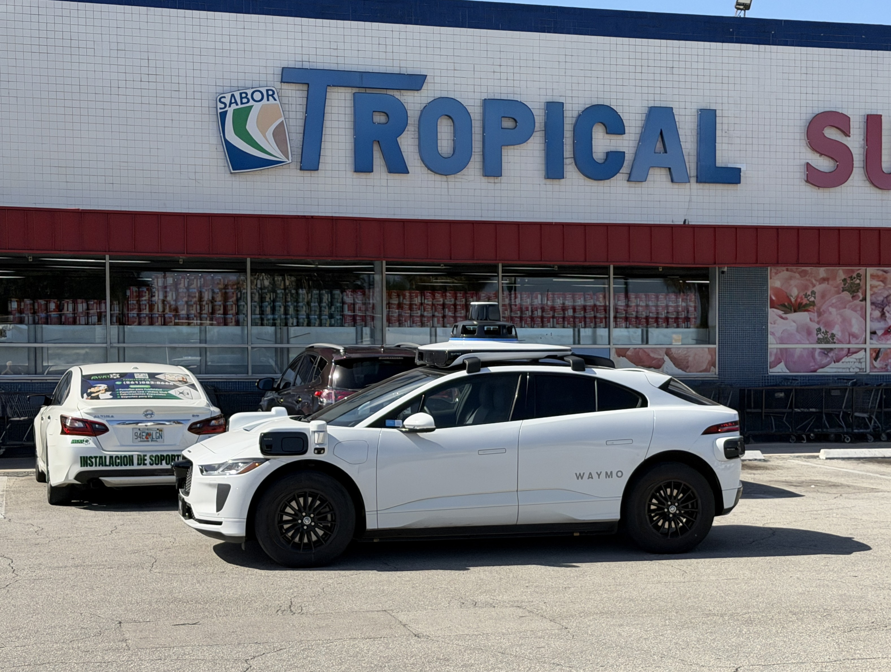
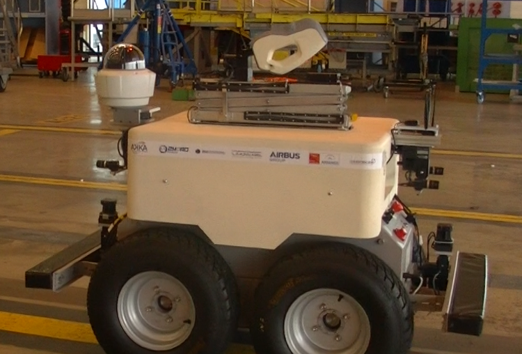
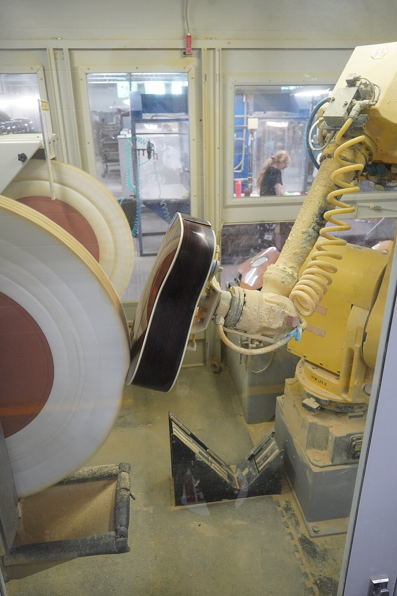
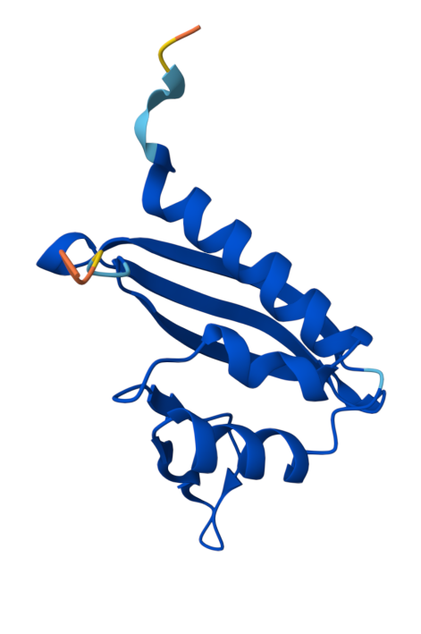
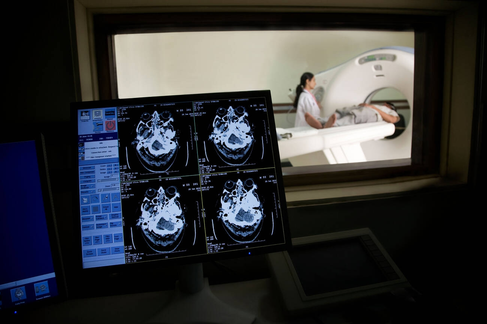
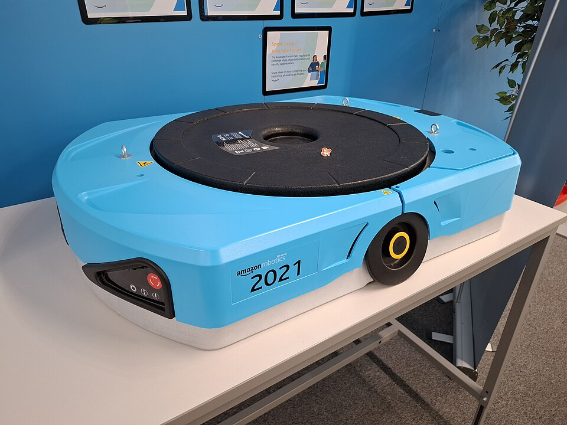

<h1>Applications of ANNs</h1>

**CS112, Intro to AI**

<h2>Table of Contents</h2>

[TOC]

## The End of the AI Winter

The *AI winter* was a long stretch, from the late 1970s into the early 1990s, when disappointing results led to deep cuts in AI funding and interest (see [History of AI Part 2](CS112-Topic04-1-History.html)).

Neural nets survived in a few research labs, and three things came together around 2010 to bring them back. First, there was **data**: ImageNet, released in 2009, gave researchers millions of labeled photos to train on. Second, there was **computing power**: graphics cards (GPUs), built for video games, turned out to be very good at the math ANNs need, so training that once took months now took days. Third, there were **better training methods**, building on the backpropagation work of Hinton and others. In 2012, a CNN called AlexNet won the ImageNet contest by a wide margin, and researchers and companies took notice. Funding poured back into AI, and the field has been in "summer" ever since. The revival reached factories and warehouses too: robots that once repeated fixed motions began to use cameras and ANNs to see what was in front of them.

## What ANNs Made Possible

Once ANNs could be trained on large amounts of data, problems that had resisted AI for decades began to fall. Before large language models and ChatGPT (2022), most of these ANNs *recognized* and *predicted* rather than created:

- **Recognizing images**: tagging people in photos, unlocking a phone with your face, and reading handwriting and street signs.
- **Understanding speech**: ANN-based voice assistants and automatic captions understood spoken language far better than the early command-and-control assistants did.
- **Translating languages**: Google Translate switched to neural networks in 2016, and the quality jumped noticeably.
- **Driving**: self-driving cars use ANNs to recognize pedestrians, lane lines, and traffic signals.
  

  *A Waymo self-driving car. Photo: Phillip Pessar, [CC BY 4.0](https://creativecommons.org/licenses/by/4.0/), via [Wikimedia Commons](https://commons.wikimedia.org/wiki/File:Waymo_Self_Driving_Car_in_West_Miami.jpg).*

- **Industrial automation**: factories use cameras and ANNs to inspect products for scratches, cracks, and other defects, often faster and more consistently than a tired human eye. Some inspection robots even move around on their own, such as Air-Cobot, a research robot that checks aircraft for damage during maintenance.
  

  *Air-Cobot, a mobile robot that inspects aircraft during maintenance, in an Air France Industries hangar. Photo: Stanislas Larnier, [CC BY-SA 4.0](https://creativecommons.org/licenses/by-sa/4.0/), via [Wikimedia Commons](https://commons.wikimedia.org/wiki/File:AFI_03_2016_Air-Cobot_in_hangar.png).*

- **Robotics**: traditional industrial robot arms repeat the same programmed motion over and over, so everything has to be in exactly the right place. ANNs let robots use cameras to find and handle objects that vary. In a well-known 2016 experiment, Google researchers had robot arms practice grasping hundreds of thousands of times, and a CNN learned to pick up objects it had never seen. In 2019, OpenAI trained a robot hand to turn and solve a Rubik's Cube, with the ANN learning almost entirely in a computer simulation before it was tried on the real hand.
  

  *A traditional industrial robot arm holds a guitar body against a polishing wheel at the C.F. Martin Guitar Factory. Photo: Henrysz, [CC BY 4.0](https://creativecommons.org/licenses/by/4.0/), via [Wikimedia Commons](https://commons.wikimedia.org/wiki/File:Robotic_Arm_Polishing_Guitars_at_Martin_Guitar_Factory.jpg).*

- **Playing games**: AlphaGo's 2016 win over Go champion Lee Sedol, a feat experts had expected to be years away.
- **Medicine and science**: ANNs help find tumors in medical scans, and AlphaFold predicts the 3D shapes of proteins, a problem that had stumped biologists for 50 years. Because a protein's shape determines what it does, AlphaFold's predictions, now freely available for more than 200 million proteins, speed up drug design and disease research, and its creators shared the 2024 Nobel Prize in Chemistry.
  

  *A protein structure predicted by AlphaFold. Public domain, via [Wikimedia Commons](https://commons.wikimedia.org/wiki/File:AlphaFold_predicted_structure_of_human_G3BP1.png).*

## How ANNs Changed Work

These ANNs did not simply replace people. In most jobs they changed what people did all day, and people had to learn new skills to keep up. Before large language models and ChatGPT, the pattern was usually the same: the ANN did the first pass, and a person checked, corrected, or acted on the result.

- **Radiologists** began working with software that flags suspicious spots on scans and moves urgent cases, such as a suspected stroke, to the top of the reading list. The radiologist still makes the diagnosis, but now has to decide when to trust the flag and when to overrule it.
  

  *A CT brain scan in a radiology setting. Photo: Goleisureintl, [CC BY 4.0](https://creativecommons.org/licenses/by/4.0/), via [Wikimedia Commons](https://commons.wikimedia.org/wiki/File:CT_Brain_Scan.jpg).*

- **Translators** increasingly started from a machine translation and *post-edited* it, fixing errors instead of translating from scratch. The skill shifted from producing text to spotting subtle mistakes in text that looks fluent.
- **Bank fraud analysts** stopped searching for suspicious transactions by hand. ANNs score every transaction, and analysts investigate the small number that get flagged.
- **Customer service agents** found that speech recognition and automated phone menus handled the simple requests, such as checking a balance or resetting a password. The calls that reached a person were the harder, more emotional ones, so the job shifted toward problem solving and dealing with upset customers.
- **Factory quality inspectors** went from checking every part by eye to reviewing the parts that a camera and an ANN flagged as possible defects. They had to learn when the system could be trusted and when a flagged part was a false alarm.
- **Warehouse workers** share the floor with robots. In 2025 Amazon reported that it had put its one millionth robot to work in its warehouses. Robots carry shelves and packages to workers, and people spend more of their day picking, packing, and monitoring than walking the aisles.
  

  *A drive-unit robot of the kind used in Amazon fulfilment centres. Photo: Auledas, [CC BY 4.0](https://creativecommons.org/licenses/by/4.0/), via [Wikimedia Commons](https://commons.wikimedia.org/wiki/File:BRS2_Amazon_fulfilment_centre_drive_unit_robot.jpg).*

- **Robot technicians and programmers** became more in demand. When a robot learns from examples instead of following fixed instructions, someone has to collect the examples, test the robot, and keep it working.
- **Data labelers** were a new kind of worker. ImageNet's millions of photos were labeled by crowd workers, and every ANN that learns from examples needs people to supply them.

Across these jobs, the same lessons keep coming up:

- People moved from *doing* the task to *supervising* it. 
- They needed enough expertise to catch the ANN's mistakes. 
- They had to guard against trusting the ANN too much, because an AI generated answer is not always a correct one. 

## Concerns That Came with Success

As ANNs moved into photos, hiring, policing, healthcare, and driving, their problems became public too. Most of these concerns came from ANNs that *recognize* and *predict*, before large language models:

- **Bias**: an ANN learns from the data it is given, so it can copy the unfairness in that data. A 2018 study, *Gender Shades*, found that commercial face recognition was far less accurate for darker-skinned women than for lighter-skinned men. ProPublica's 2016 analysis of a tool used to predict whether defendants would reoffend found that it made different kinds of errors for Black and white defendants. A 2019 study found that a widely used healthcare algorithm underestimated how sick Black patients were.
- **Surveillance and privacy**: face recognition let police, governments, and companies identify people in public, often without their knowledge or consent.
- **Safety**: in 2018 a self-driving test car operated by Uber struck and killed a pedestrian, which raised the question of who is responsible when an ANN makes a fatal mistake. The same question applies to robots that work beside people in factories and warehouses, where a robot that misjudges its surroundings can injure someone.
- **Black boxes**: an ANN can't explain why it gave an answer, which is a problem when the answer affects someone's medical care, loan, or job.
- **Labor**: the work changes described above helped some people and displaced others, and the data labelers who made ANNs possible were often paid very little. Factory and warehouse automation raised the same worry: robots can make some jobs safer and less tiring, but they can also reduce the number of workers needed.
- **Energy and the environment**: training large ANNs takes a lot of electricity. One widely cited 2019 study estimated that building a large language model with extensive tuning could produce as much carbon dioxide as five cars over their lifetimes.

Around 2017, a different kind of concern appeared. ANNs that *generate* realistic images and video made it possible to create convincing fakes, called *deepfakes*. That is early generative AI, and we'll return to it in a later topic.

## Reference

[History of AI Part 2](CS112-Topic04-1-History.html)&mdash;Brian Bird.

Krizhevsky, A., Sutskever, I., & Hinton, G. (2012). [ImageNet Classification with Deep Convolutional Neural Networks](https://papers.nips.cc/paper/2012/hash/c399862d3b9d6b76c8436e924a68c45b-Abstract.html). *NeurIPS 25*.&mdash;The AlexNet paper.

LeCun, Y., Bengio, Y., & Hinton, G. (2015). [Deep learning](https://www.nature.com/articles/nature14539). *Nature, 521*, 436&ndash;444.&mdash;Overview written by the three pioneers.

Buolamwini, J., & Gebru, T. (2018). [Gender Shades: Intersectional Accuracy Disparities in Commercial Gender Classification](https://proceedings.mlr.press/v81/buolamwini18a.html). *Proceedings of Machine Learning Research, 81*.

Angwin, J., Larson, J., Mattu, S., & Kirchner, L. (2016). [Machine Bias](https://www.propublica.org/article/machine-bias-risk-assessments-in-criminal-sentencing). *ProPublica*.

Obermeyer, Z., Powers, B., Vogeli, C., & Mullainathan, S. (2019). [Dissecting racial bias in an algorithm used to manage the health of populations](https://www.science.org/doi/10.1126/science.aax2342). *Science, 366*, 447&ndash;453.

Levine, S., Pastor, P., Krizhevsky, A., Ibarz, J., & Quillen, D. (2018). [Learning hand-eye coordination for robotic grasping with deep learning and large-scale data collection](https://arxiv.org/abs/1603.02199). *The International Journal of Robotics Research, 37*(4&ndash;5).&mdash;The Google robot grasping experiment.

OpenAI. (2019). [Solving Rubik's Cube with a Robot Hand](https://arxiv.org/abs/1910.07113). *arXiv:1910.07113*.

Czimmermann, T., et al. (2020). [Visual-Based Defect Detection and Classification Approaches for Industrial Applications&mdash;A Survey](https://www.mdpi.com/1424-8220/20/5/1459). *Sensors, 20*(5), 1459.

Szkutak, R. (2025). [Amazon deploys its 1 millionth robot, releases generative AI model](https://techcrunch.com/2025/07/01/amazon-deploys-its-one-millionth-robot-releases-generative-ai-model/). *TechCrunch*.

Strubell, E., Ganesh, A., & McCallum, A. (2019). [Energy and Policy Considerations for Deep Learning in NLP](https://arxiv.org/abs/1906.02243). *ACL 2019*.

### Interactive Web Pages

[Quick, Draw!](https://quickdraw.withgoogle.com/)&mdash;Google.  
Draw a doodle and see whether an ANN can guess what it is. Notice when it gets it wrong, and think about why a person still needs to check its answers.

[Teachable Machine](https://teachablemachine.withgoogle.com/)&mdash;Google.  
Train your own image or sound classifier with your webcam or microphone, with no coding. The examples you give it are the labeled data, the same kind of work data labelers do.

[Google Translate](https://translate.google.com/)&mdash;Google.  
Translate a sentence into a language you know and look for subtle errors in text that sounds fluent. This is the job of a translator who post-edits machine translation.

[AlphaFold Protein Structure Database](https://alphafold.ebi.ac.uk/)&mdash;EMBL-EBI and Google DeepMind.  
Search for a protein and rotate its predicted 3D shape to see what AlphaFold produces.

---

 Intro to AI lecture notes by [Brian Bird](https://profbird.dev), written in 2024, revised in <time>2026</time>, are licensed under a [Creative Commons Attribution-ShareAlike 4.0 International License](http://creativecommons.org/licenses/by-sa/4.0/). 

*Note: GPT-4 and GPT-4o were used to draft some parts of these notes.*