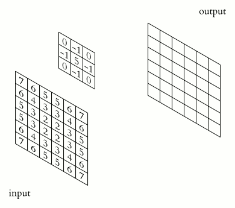
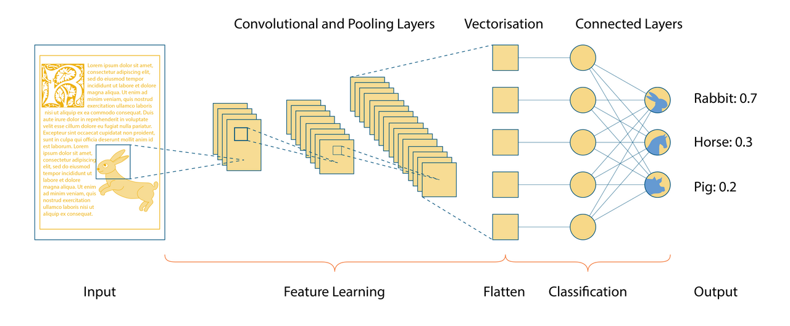
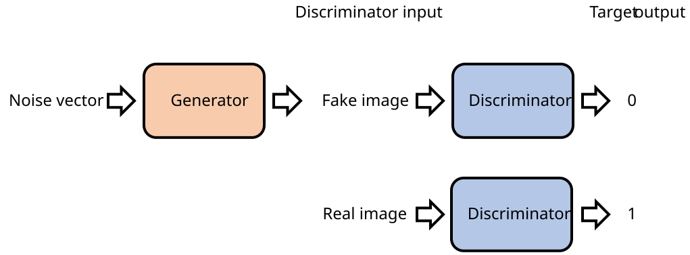

<h1>Special Types of ANNs</h1>

**CS112, Intro to AI**

<h2>Contents</h2>

[TOC]

## Convolutional Neural Networks (CNNs)

When we tried to assign weights to a perceptron that classified happy and sad faces, we discovered that the perceptron (or an ANN) had difficulty with:

- Different sizes of a particular objects (like someone's face) in an image.
- Objects that were positioned higher or lower in the overall image frame.
- Features (mouth size and position) that varied from object to object.

*Convolutional neural networks* (CNNs) are much better at handling these problems. They are built around an operation called *convolution*: slide a small window, called a *filter* (or *kernel*), across the image and score how well each patch of the image matches a simple pattern, such as a curved edge. The result is a map of where in the image that pattern shows up.

The filter's pattern is not chosen by a programmer. Like the weights in the ANNs you've already seen, it is <u>learned during training</u>.

Here is a simplified description of the process:

> Think of an image as a large field of different colored flowers. Now, suppose you want to identify patterns or features in this field, like areas of certain colors or color combinations.
>
> The convolution operation is like using a small magnifying glass to look at one small area of the field at a time. 
>
> As you move the magnifying glass across the field (or the image), you're focusing on one small area at a time. For each area, you're asking, "What's interesting here?" The answer could be "a lot of red flowers," "mostly blue flowers," "a mix of red and blue flowers," and so on. These are the "features" that the filter is learning to recognize.
>
> The interesting thing is, you use the same magnifying glass (the same filter) to look at the entire field. This means you're looking for the same kind of features everywhere in the image. This is what gives CNNs their power: they can recognize the same features no matter where they appear in the image.
>
> In summary, the convolution operation in a CNN is like using a magnifying glass to systematically scan across an image, looking for interesting features one small area at a time.

<figure>

<figcaption>A filter sliding across an image, scoring one patch at a time. By <a href="https://commons.wikimedia.org/wiki/File:2D_Convolution_Animation.gif">Michael Plotke</a>, <a href="https://creativecommons.org/licenses/by-sa/3.0/">CC BY-SA 3.0</a>, via Wikimedia Commons.</figcaption>
</figure>

A real CNN uses many filters at once, arranged in layers. Early layers find simple things like edges and corners. Later layers combine those into eyes and mouths, and the last layers combine those into whole faces. Because the same filter scans the whole image, it doesn't matter whether a face is high or low in the picture.

<figure>

<figcaption>The layers of a CNN, from input image to classification. By <a href="https://commons.wikimedia.org/wiki/File:Convolutional_Neural_Network.png">Irisbox</a>, <a href="https://creativecommons.org/licenses/by/4.0/">CC BY 4.0</a>, via Wikimedia Commons.</figcaption>
</figure>

### A Small CNN in Action

The <u>demo linked at the bottom of these notes</u> runs a small, real CNN that recognizes handwritten digits. It works in four steps:

1. **Look for small patterns.** Eight small filters slide over the picture. Each one looks for a different simple stroke, such as an edge or a curve.
2. **Shrink the results (pooling).** The results are boiled down to "was this pattern found around here?" The exact position is thrown away.
3. **Combine into bigger patterns.** A second set of sixteen filters looks at the results of step 1 and finds things like loops, corners, and crossings. The results are shrunk again.
4. **Decide.** The remaining numbers go into a small ordinary ANN, like the ones in the first part of this course. It gives each digit, 0 through 9, a score, and the highest score wins.

**The CNN doesn't center the digit.** In this demo, ordinary code does that *before* the CNN sees anything. It finds the edges of your drawing, centers it, and resizes it to fit a small grid. The demo's author found that without this step, a drawn 4 was recognized as a 7. So the demo can't show how a CNN copes with different sizes and positions, because the preprocessing has already removed those differences.

### Why Not Just Use a Plain ANN?

A plain ANN connects every pixel to every neuron, and it has no idea that neighboring pixels belong together. A CNN builds in two ideas:

- **Reuse the same filter everywhere.** A pattern learned in one place is recognized in every place, so the position of a feature matters much less.
- **Build up from small to large.** Strokes become loops and corners, and those become digits. This is the same layering we described for faces.

These ideas also save weights. The demo's CNN has about 28,000 weights, while a plain ANN with just one layer of 64 neurons would need about 50,000. On neatly centered digits like the ones in this demo, a small plain ANN also does well, so the demo can't show the difference. A CNN's advantage appears when the digit is shifted, because the same filters still find the same strokes.

### Where CNNs Are Used

- Unlocking a phone with your face.
- Tagging people and objects in photos.
- Finding tumors and other problems in medical images.
- Helping self-driving cars recognize pedestrians, signs, and lane markings.

### History of CNN Development

CNNs were first developed in the 1980s. Early foundational work was done by Kunihiko Fukushima, and then by Yann LeCun.

In 1989, LeCun's team built a CNN that read handwritten zip codes. It was one of the first CNNs trained with *backpropagation*, a method that adjusts a network's weights by working backward from its mistakes. In 1998 LeCun introduced LeNet-5, a refined version used to recognize handwritten digits on bank checks.

CNNs then sat mostly in the background for about 20 years. The breakthrough came in 2012 with *AlexNet*, created by Alex Krizhevsky, Ilya Sutskever, and Geoffrey Hinton. AlexNet won the 2012 ImageNet contest by a wide margin. Its list of five best guesses contained the correct answer about 85% of the time (a 15% error rate), while the runner-up missed about 26% of the time.

Two things made this possible: huge collections of labeled images (such as ImageNet) and fast graphics chips (GPUs) that could train big networks in a reasonable time.

## Generative Adversarial Networks (GANs)

A *generative adversarial network* (GAN), introduced by Ian Goodfellow and colleagues in 2014, uses two networks that compete against each other:

- The **generator** creates images meant to look like the ones in the training data.
- The **discriminator** looks at an image and guesses whether it is real (from the training data) or fake (made by the generator).

A good analogy is a forger and an art detective. The forger (generator) starts out producing random-looking noise, and the detective (discriminator) says "fake." The forger adjusts and tries again. Each round the forger gets better at fooling the detective, and the detective gets better at spotting fakes. Eventually the forger's images look real.

<figure>

<figcaption>How a GAN is set up. By <a href="https://commons.wikimedia.org/wiki/File:Generative_Adversarial_Network_illustration.svg">Mtanti</a>, <a href="https://creativecommons.org/licenses/by-sa/4.0/">CC BY-SA 4.0</a>, via Wikimedia Commons.</figcaption>
</figure>

Notice that the generator never sees the real images. It learns only from the discriminator's feedback.

GANs can produce realistic fake faces, artwork, and enhanced photos. They are also used to make *deepfakes*, which raises the ethical questions we'll discuss later. Newer *diffusion models* have largely overtaken GANs for image generation. We'll look at them when we discuss generative AI and LLMs.

## Interactive Web Pages

[Handwritten Digit Recognition AI](https://tomoiura.github.io/digit_recognizer/?lang=en)&mdash;Tomohisa Iura.  
Draw a digit with your mouse or finger and watch a small CNN recognize it as you draw. The network diagram lights up the paths that carried the most signal. Try drawing a digit slowly and watch the scores change after each stroke. Remember that the drawing is centered and resized *before* the CNN sees it.

---

[Designed to Deceive: Do These People Look Real to You?](https://www.nytimes.com/interactive/2020/11/21/science/artificial-intelligence-fake-people-faces.html)&mdash;Kashmir Hill and Jeremy White, New York Times, Nov. 21, 2020.  
In this interactive demo, the sliders control features the GAN discovered on its own while training, such as age or hair color.

*Several different AI models including GPT-4o and Claude Sonnet 5.5 were used to draft and revise parts of these notes.*

---

 Intro to AI lecture notes by [Brian Bird](https://profbird.dev), written in 2024, revised and expanded in <time>2026</time>, are licensed under a [Creative Commons Attribution-ShareAlike 4.0 International License](http://creativecommons.org/licenses/by-sa/4.0/). 

---

