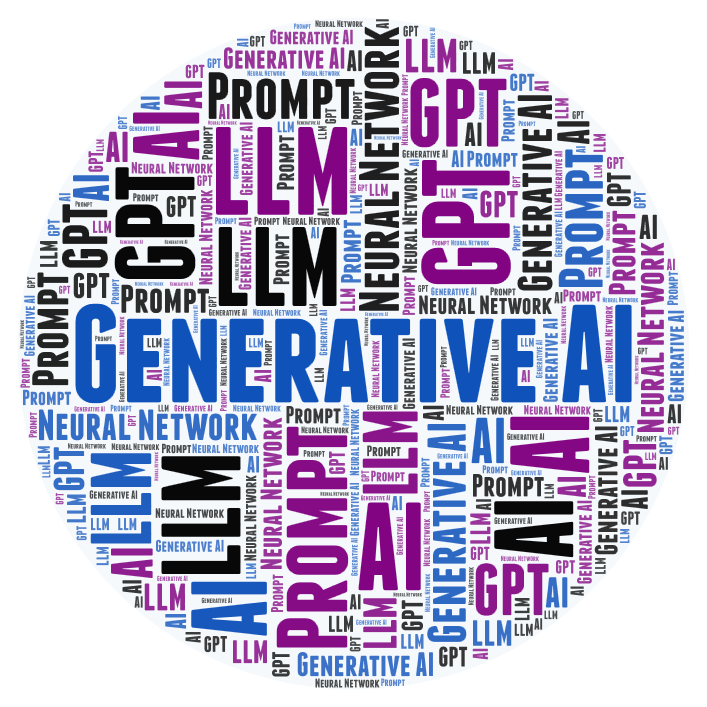

**CS 112, Intro to AI**

<h1>Week 7 Overview for Fall 2026</h1>

<h2>Nov. 9 through Nov. 15</h2>

| Topics                                                       |                                                |
| ------------------------------------------------------------ | ---------------------------------------------- |
| Overview of AI                                               | Neural networks and deep learning              |
| AI Problem Solving Revisited Machine Learning&mdash;Part 1 Applications of AI | <mark>Generative AI</mark> + Prompt engineering |
| Machine Learning&mdash;Part 2                                | Custom chatbot creation                        |
| History of AI, Robotics and Midterm                          | Social and ethical issues of AI   Final   |

## This Week's Learning Objectives

  

    
By the end of this week you will be able to:

    <ul style="margin-bottom: 0;">
      <li>Explain what generative AI is and how it differs from the AI you have studied so far.</li>
      <li>Discuss what generative AI can and can't do well and risks related to this technology.</li>
      <li>Use a GPT Chatbot (like Chat GPT) and explore different ways it can be used.</li>
    </ul>
  

  <figure style="flex: 0 0 200px; width: 200px; margin: 0 auto;">
    
  </figure>

## Announcements and Discussion

- **Wed., Nov. 11: Veterans Day.** The college is closed.
- **Drop-in Winter Reg Fest** on Saturday, Nov. 14 from 9am&ndash;2pm in Building 1, Admissions 102.
  Get help with admissions, financial aid, academic advising and registration.
  Plan to arrive before 1pm. There is another one on Tuesday, Dec. 1, 9am&ndash;2pm.
- Anything else?

## Things to Do This Week

Due this Sunday, 11/15 (the usual):

- Forum post with questions, answers and comments for online students
  (Part of your participation grade).
- Exercises on Generative AI, based on the NY Times articles.
- Quiz over the lectures.

Due next Thursday, 11/19:

- Project 2, using AI for a simulated work activity.

---

 Intro to AI Course Materials by <a href="https://profbird.dev" target="_blank">Brian Bird</a>, written in 2025, revised in <time>2026</time>, are licensed under a <a href="http://creativecommons.org/licenses/by-sa/4.0/" target="_blank">Creative Commons Attribution-ShareAlike 4.0 International License</a>. 

---
