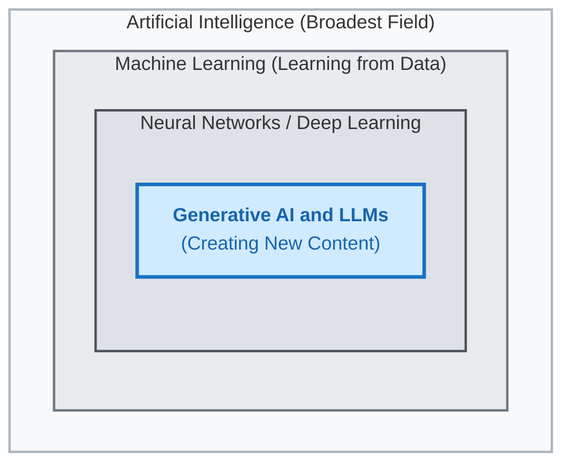
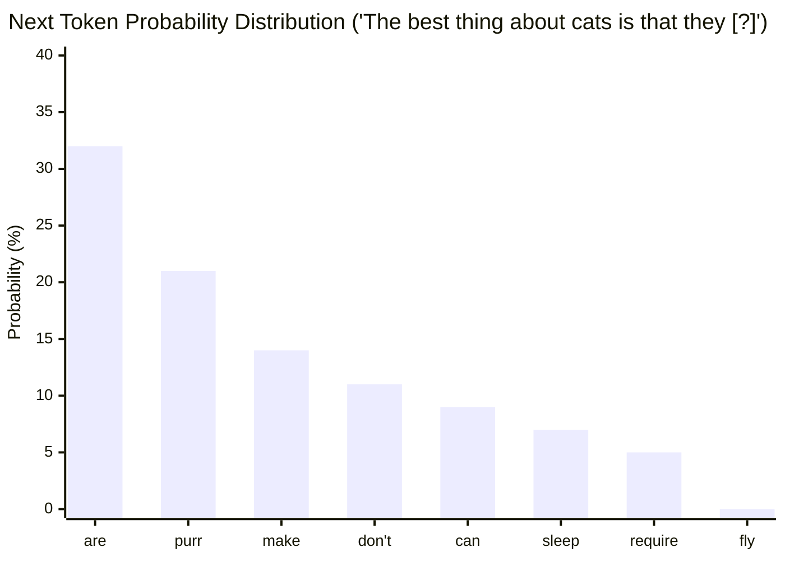

<h1>Generative AI</h1>

**CS112, Intro to AI**

<h2>Contents</h2>

[TOC]

## Overview

Generative AI is a subset of machine learning (ML) that is used for creating new content. Generative models use neural networks to generate data based on, but different from, the data they were trained on. 

*Figure: Generative AI sits within the broader fields of Neural Networks, Machine Learning, and Artificial Intelligence (Source: Wikimedia Commons, CC BY-SA 4.0).*

OpenAI released a public demo of ChatGPT on November 30, 2022 that took the world by storm and suddenly generative AI was the new sensation.

A Generative Pretrained Transformer (GPT) chatbot, like ChatGPT, works by taking a prompt (often a question or instruction) as input and generating a response (an answer) based on statistical probabilities.

- It is *generative* because it creates new output (such as text, code, or images) rather than merely classifying existing data. 
- It is *pretrained* because it has already learned language patterns from massive text training datasets before being deployed to users.
- It is a *transformer* because it uses the *transformer neural network architecture*, which processes words across an entire prompt simultaneously to weigh how every word relates to every other word.
  - *Attention* is the key mechanism inside a transformer. While earlier AI models read text strictly left-to-right—without tracking relationships between words—attention examines all the words at once. Think of it as a smart highlighter: it flags the central ideas that carry the true meaning of a message. By weighing how strongly words relate to each other, attention helps the model track topics, resolve pronouns, and filter out conversational filler.

## Large Language Models

  A *Large Language Model* (LLM) is an AI model built on the transformer architecture, scaled up across billions of parameters and immense amounts of text data. What makes an LLM unique compared to older, single-purpose language software is its versatility: rather than being trained for only one specific task, a single LLM can draft essays, write and debug software code, translate between languages, summarize research, and reason through conversational problem-solving out of the box.

### Tokens

A *token* is the basic unit of text that a language model reads and generates. Tokens can be whole words, subwords, or even individual characters and punctuation marks, depending on the tokenizer used. 

For example, a common phrase might tokenize word-for-word, but longer, rare, or compound words are broken into smaller chunks (e.g., "unbreakable" might split into "un", "break", and "able"). A helpful rule of thumb for English text is that 1 token roughly corresponds to 0.75 words (or 100 tokens *`≈`* 75 words).

## Training an LLM

A large language model is primarily trained using *self-supervised learning* on vast amounts of text data from diverse sources like books, articles, code repositories, and websites. 

In self-supervised pretraining, the model learns grammar, facts, and reasoning patterns simply by repeatedly predicting masked or missing next tokens without needing human labels. Training frontier models requires massive computational clusters running thousands of GPUs for weeks or months. 

> Self-supervised learning (SSL) is a form of machine learning where the system creates its own labels directly from raw, unlabelled data by hiding parts of the input and trying to predict them. Unlike traditional unsupervised learning, which simply looks for patterns or groupings across data without grading itself, self-supervised learning invents a prediction task with a clear right-or-wrong answer so it can automatically check its work.

After initial pretraining, models undergo fine-tuning and *Reinforcement Learning from Human Feedback (RLHF).* This alignment step teaches the model to behave as a safe, helpful conversational assistant rather than just an unpredictable text predictor. The result is a tool capable of generating coherent, human-like responses.[^1]

### Parameters

LLM parameters are the internal numerical values that define how the network processes information. These parameters primarily consist of the *weights* and *biases* across the neural network layers, which are adjusted during training to minimize prediction error. 

The number of parameters in models varies widely: compact models built to run on personal computers or phones typically have 3 to 8 billion parameters, whereas flagship frontier[^2] models that power tools like ChatGPT, Claude, and Gemini have 1 to 2 trillion or more parameters. (The exact numbers aren't revealed by the companies providing these models.)

## Using an LLM (Inference)

When a user submits a prompt, the trained model generates output through a process called *inference*. 

The process of generating output is iterative:

1. The prompt is converted into tokens.
2. Based on the prompt's tokens, the model calculates the probability distribution across its entire vocabulary—determining how likely each possible token is to come next.
3. The model samples one candidate token based on these probabilities (governed by settings such as *temperature*).
4. The newly selected token is appended to the prompt, and the model repeats step 2 to choose the next token.
5. This cycle continues until the model predicts a dedicated *End of Sequence (EOS / Stop)* token, or reaches a user-specified token limit.

### Context Length

The *context length* (or *context window*) of an LLM refers to the maximum number of tokens it can hold in its active memory at one time, encompassing both the input prompt and the generated response. 

Early generative models like GPT-3 had a context length of 4,096 tokens, while GPT-4 initially expanded to 8,192 and 32,768 tokens. Modern frontier models feature context windows ranging from 128,000 tokens up to 1,000,000+ tokens—allowing them to analyze hundreds of pages of documentation, entire books, or extensive codebases in a single session.

## Practical Considerations & FAQ

- **Are my prompts used to train the LLM?**  
  By default on many free consumer services, input prompts and conversations may be reviewed and used to train future iterations of the model unless users explicitly opt out in privacy settings or use enterprise/API tiers.

- **Is my feedback (thumbs up/down) used to train the LLM?**  
  Yes. Thumbs up/down ratings, corrections, and alternate completions provide feedback data used in reinforcement learning (RLHF) and model alignment pipelines.

- **Are my prompts kept private?**  
  Not necessarily. Cloud chatbots transmit your prompts over the internet to remote data centers. Prompts may be logged for trust and safety audits, reviewed by human evaluators, or retained in service logs. Sensitive personal data, passwords, or confidential materials should never be pasted into public AI tools.

- **Have current AI models attained Artificial General Intelligence (AGI)?**  
   By most scientific standards, no. While there is debate over how to define AGI, current models are pattern-matching and probabilistic reasoning engines. They excel at specific benchmark tests, professional exams, and digital workflows, but they still lack common-sense causal reasoning, continuous real-world learning, and independent agency. Whether scaling current architectures will eventually bridge this gap or if entirely new breakthroughs are required remains one of the central debates in computer science.

- **What are the top uses for GPT Chatbots?**
  1. **Tutoring & Concept Explanation**: Clarifying complex ideas, breaking down study material, and providing stepped explanations.
  2. **Drafting & Editing**: Assisting in outlining essays, formatting content, rewriting prose, and brainstorming ideas.
  3. **Coding & Technical Assistance**: Explaining compiler errors, generating boilerplate code, and debugging syntax issues.
  4. **Research Assistance & Summarization**: Distilling long documents, extracting key themes, and synthesizing reading materials.
  5. **Language Translation & Practice**: Translating text across languages and practicing conversational dialogue.
  6. **Customer Support & Workflow Automation**: Automating initial customer inquiries, routing tickets, and answering common policy questions.

- **How do I know if a chatbot is hallucinating?**  
  Because models predict plausible word sequences rather than querying a verified truth database, they can confidently state incorrect facts or generate fictitious references. The only reliable way to catch a hallucination is to manually verify claims against primary sources, check provided citations independently, and test assertions when factual accuracy is critical.

- **What are the key limitations of GPT chatbots?**
  - **Knowledge Cutoffs vs. Live Web Retrieval**: Base models only know what existed in their training data up to their cutoff date; models that browse the web can pull newer information, but may still misinterpret or misquote live web pages.
  - **Fictitious Citations**: Models can generate realistic-looking book titles, author names, DOIs, and URLs that do not exist.
  - **Lack of Real World Experience & Ground Truth**: Models manipulate language tokens based on statistical associations, not lived experience or verified understanding.
  - **Unsuitable for Crisis or Clinical Care**: While chatbots can provide basic psychoeducational resources, they are not licensed professionals and should never be used as a substitute for mental health counseling or crisis intervention.
  - **Subjective Recommendations**: Chatbots cannot genuinely "prefer" or evaluate subjective quality; their recommendations reflect the prevailing biases and distribution of their training corpus.

## Interactive Web Pages

[Tokenizer](https://platform.openai.com/tokenizer)&mdash;OpenAI. Visualizes the tokenization process. 

[Generative AI Exists because of the Transformer](https://ig.ft.com/generative-ai/)&mdash; [Visual Storytelling Team](https://www.ft.com/visual-and-data-journalism) and [Madhumita Murgia](https://www.ft.com/madhumita-murgia) . Financial Times. 2023

[Transformer Explainer](https://ig.ft.com/generative-ai/)&mdash;Aeree Cho, Grace C. Kim, Alexander Karpekov, Alec Helbling, Jay Wang, Seongmin Lee, Benjamin Hoover, and Polo Chau. Georgia Institute of Technology. 2024.

## References

[How Transformers Work: A Detailed Exploration of Transformer Architecture](https://www.datacamp.com/tutorial/how-transformers-work)&mdash;Josep Ferrer, DataCamp, 2024

[Large language model](https://en.wikipedia.org/wiki/Large_language_model)&mdash;Wikipedia

[AI’s understanding and reasoning skills can’t be assessed by current tests](https://www.sciencenews.org/article/ai-understanding-reasoning-skill-assess)&mdash;Ananya, Science Direct, 2024.

[Levels of AGI: Operationalizing Progress Toward Artificial General Intelligence](https://arxiv.org/abs/2311.02462)&mdash;Morris, M. R., Sohl-Dickstein, J., Fiedel, N., Warkentin, T., Dafoe, A., Schmitt, M., et al. ACM Queue, 22(2). 2024

[GPT-4](https://openai.com/index/gpt-4-research/)&mdash;OpenAI

[^1]: LLMs  don't actually "understand" text in the way humans do. Instead, they analyze and process text based on patterns they have learned from training data. They are sophisticated tools that excel at mimicking human-like text but do not possess genuine understanding, comprehension or awareness.
[^2]:   A frontier model is an AI system at the leading edge of current capabilities, trained on the largest scale of compute and data to deliver state-of-the-art performance across broad reasoning, coding, and problem-solving tasks.

---

 Intro to AI lecture notes by [Brian Bird](https://profbird.dev), written in 2024, revised in <time>2026</time>, are licensed under a [Creative Commons Attribution-ShareAlike 4.0 International License](http://creativecommons.org/licenses/by-sa/4.0/). 

---

Note: Microsoft Copilot with GPT-4 was used to draft parts of these notes, Gemini 4.0 Argon was used to assist with revisions.
